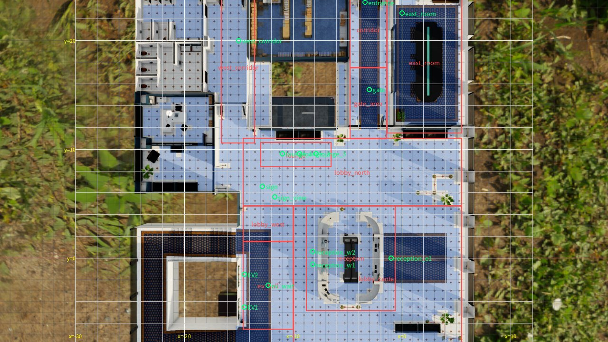

# JSON configuration tutorial

[日本語](config-tutorial.md) ｜ **Tutorial** ｜ [Reference](config-reference.en.md) ｜ [Using Python](library.en.md) ｜ [Code examples](../examples/README.en.md)

Write one JSON configuration file and build it up step by step to try what twinsim can do. Read from the top to learn how to write streams of people, cameras, elevators and videos.
To look up a key, see the [reference](config-reference.en.md).

## Contents

1. [Setup and how to run](#setup)
2. [The smallest configuration](#first)
3. [Changing the amount of people](#amount)
4. [Splitting destinations](#destinations)
5. [Stopping on the way](#stops)
6. [Changing where people appear](#origin)
7. [Placing cameras and getting labels](#cameras)
8. [Using literature values](#literature)
9. [Running elevators](#elevator)
10. [Making videos](#video)
11. [Comparing conditions](#compare)
12. [Reading errors](#errors)
13. [What to read next](#next)

<a id="setup"></a>

## 1. Setup and how to run

Installation is in the [README](../README.en.md). When working inside the repository, put `uv run` in front of the commands on this page.

Write the configuration to `config.json`, then run these commands in order.

```bash
twinsim validate config.json               # check the configuration (no simulation)
twinsim run config.json --out runs/first   # simulate (CPU only, a few seconds)
```

You can also call it from Python.

```python
import twinsim

result = twinsim.simulate("config.json", out_dir="runs/first")
print(result.summary["people"], "people")
```

The result is written to `runs/first/`. Look at these two files first.

| File | Contents |
|---|---|
| `summary.json` | Summary: number of people, maximum present at once, people per stream, and so on |
| `preview.png` | People's trajectories drawn on the top-down image |

<a id="first"></a>

## 2. The smallest configuration

People walk from the office entrance to the south exit. The only required key is `space`; to create people, also write `streams`.

```json
{
  "name": "tutorial",
  "space": "office",
  "duration_s": 60,
  "streams": [
    {
      "name": "commuters",
      "origin": "entrance",
      "rate": 20,
      "destinations": ["south_exit"]
    }
  ]
}
```

- `space`: the name of the space. `twinsim spaces` lists them.
- `duration_s`: how long to simulate (seconds).
- `streams`: the list of streams of people.
- `origin`: where people appear.
- `rate`: arrivals per minute. It is not the same number every time; arrivals are random with this average.
- `destinations`: where people go.

Names such as `entrance` and `south_exit` are defined for each space. The list is in the [reference](config-reference.en.md#places).

→ Reference: [`streams[]`](config-reference.en.md#streams)

<a id="amount"></a>

## 3. Changing the amount of people

From here on, only part of the configuration is shown. Replace the keys shown here.

To vary the amount of people over time, make `rate` a `piecewise` rate. List `[seconds, rate]` pairs, which are joined by straight lines. In this example, the busiest moment is at 30 seconds.

```json
"streams": [
  {
    "name": "commuters",
    "origin": "entrance",
    "rate": {"type": "piecewise", "per_min": [[0, 5], [30, 30], [60, 5]], "unit": "persons"},
    "group_size": {"type": "zero_truncated_poisson", "lam": 0.2},
    "destinations": ["south_exit"]
  }
]
```

- `unit: "persons"`: count the rate in people per minute. Without it, the rate is groups per minute.
- `group_size`: the distribution of how many people walk together. A larger `lam` gives more groups.

→ Reference: [`rate`](config-reference.en.md#rate), [distributions](config-reference.en.md#distributions)

<a id="destinations"></a>

## 4. Splitting destinations

With several destinations, one is chosen by the weight `p`. `via` lists the gates to pass on the way.

```json
"streams": [
  {
    "name": "commuters",
    "origin": "entrance",
    "rate": 20,
    "destinations": [
      {"to": "south_exit", "p": 0.7, "via": ["gate"]},
      {"to": "west_corridor", "p": 0.2},
      {"to": "east_room", "p": 0.1}
    ]
  }
]
```

The weights do not need to add up to 1.

→ Reference: [`destinations[]`](config-reference.en.md#destinations)

<a id="stops"></a>

## 5. Stopping on the way

If `to` is a place to stop at, people stop there. `dwell` is how long they stop, and `then` is the next destination. With only the start of a name, such as `reception`, one of `reception_w1` and so on is chosen.

You can also give people types and send each type to different destinations.

```json
"streams": [
  {
    "name": "staff",
    "origin": "entrance",
    "rate": 15,
    "types": "staff",
    "destinations": [{"to": "south_exit", "via": ["gate"]}]
  },
  {
    "name": "visitors",
    "origin": "entrance",
    "rate": 4,
    "types": "visitor",
    "destinations": [
      {
        "to": "reception",
        "via": ["gate"],
        "dwell": {"type": "lognormal", "median": 25, "sigma": 0.4, "min": 8, "max": 90},
        "then": "south_exit"
      }
    ]
  }
]
```

→ Reference: [`destinations[]`](config-reference.en.md#destinations), [place names](config-reference.en.md#places)

<a id="origin"></a>

## 6. Changing where people appear

`origin` can be coordinates instead of a place name. Coordinates are world coordinates (m). In the image below, blue areas are walkable and grid lines are 2 m apart.



*Office, first floor. Green marks are place names and red outlines are zones. Made with `twinsim show-space office`. Assets: NVIDIA Isaac Sim (CC BY 4.0)*

Here one stream appears at a point and another appears somewhere along a line. Use a line for an entrance that has a width.

```json
"streams": [
  {
    "name": "from_point",
    "origin": {"xy": [-3.0, 20.0]},
    "rate": 10,
    "destinations": ["south_exit"]
  },
  {
    "name": "from_door",
    "origin": {"line": [[-4.0, 20.0], [-2.0, 20.0]], "name": "north_door"},
    "rate": 10,
    "destinations": ["south_exit"]
  }
]
```

`name` inside `origin` is the label used in the counts. Without it, the stream name is used.

Coordinates outside the walkable area, or from which a destination cannot be reached, are errors before simulating. The message shows the nearest walkable point.

In the GUI, drag the green squares on the map. Hovering over the map also shows the coordinates of that point.

→ Reference: [`origin`](config-reference.en.md#origin)

<a id="cameras"></a>

## 7. Placing cameras and getting labels

With `cameras`, the boxes around people in each camera (ground-truth labels for detection and tracking) are written to `mot/<camera>.txt`. Use a candidate name from the space, or choose the position yourself.

```json
"cameras": [
  {"name": "CamGate"},
  {"name": "CamEV", "focal_mm": 10.0},
  {"name": "MyCam", "eye": [-6.0, 6.0, 2.7], "target": [-3.0, 14.5, 0.8]}
]
```

- `CamGate`: uses the candidate as it is.
- `CamEV`: changes only the focal length of the candidate.
- `MyCam`: a new camera. `eye` (position) and `target` (look-at point) are required. Both are `[x, y, z]`, where `z` is the height (m).

The labels can be read from Python. The columns are `frame, id, x, y, w, h, conf, class, visibility`.

```python
labels = result.mot("MyCam")
print(len(labels), "boxes")
```

→ Reference: [`cameras[]`](config-reference.en.md#cameras), [code example 03](../examples/03_read_labels.py)

<a id="literature"></a>

## 8. Using literature values

`people.profile` sets a group of literature values for walking speed, group size and so on. With the building population in `demand`, the amount of elevator users can be computed from the shares in the literature.

```json
"people": {"profile": "office_commute_jp"},
"demand": {"population": 600, "period": "morning", "peak_pct_5min": 12},
"streams": [
  {
    "name": "commuters",
    "origin": "entrance",
    "rate": {"type": "lift_demand", "flow": "incoming", "share": 0.9},
    "destinations": [{"to": "south_exit", "via": ["gate"]}]
  }
]
```

`share` is the part of the computed amount that goes to this stream. Each run writes `validity.md`, which shows the source of each value and a table comparing the result with the literature.

→ Reference: [`people`](config-reference.en.md#people), [`demand`](config-reference.en.md#demand), [sources of the literature values](validity.en.md)

<a id="elevator"></a>

## 9. Running elevators

With the destination `elevator`, people wait in front of the elevator and board. This destination needs the `elevator` settings.

```json
"streams": [
  {
    "name": "commuters",
    "origin": "entrance",
    "rate": 15,
    "destinations": [{"to": "elevator", "via": ["gate"]}]
  }
],
"elevator": {
  "cars": ["EV1", "EV2"],
  "capacity": 8,
  "schedule": {"type": "interval", "interval": {"type": "uniform", "min": 35, "max": 60}},
  "alight": {"count": {"type": "poisson", "lam": 1.0}, "destinations": ["south_exit"]}
}
```

- `cars`: the names of the elevator doors to use.
- `schedule`: how arrival times are decided. Here each car arrives every 35 to 60 seconds.
- `alight`: the people who get off when a car arrives.

You can also plug in your own operating rule from code ([replacing elevator operation](library.en.md)).

→ Reference: [`elevator`](config-reference.en.md#elevator)

<a id="video"></a>

## 10. Making videos

The simulations so far make no video. Videos are rendered from a result with Isaac Sim, which uses a GPU. The configuration holds the render size and whether to vary clothing colors per person.

```json
"cameras": [{"name": "CamGate"}],
"render": {"width": 1280, "height": 720, "tint": false}
```

Rendering is a separate step from the configuration.

```bash
./isaac_up.sh                                  # start Isaac Sim
twinsim render runs/first --frames 300 449     # render frames 300 to 449
isim down                                      # give the GPU back when done
```

Videos are written to `runs/first/video/<camera>.mp4`. Rendering the full length takes about 8.5 times the video length per camera, so try a short part first.

→ Reference: [`render`](config-reference.en.md#render), [code example 04](../examples/04_get_video.py)

<a id="compare"></a>

## 11. Comparing conditions

The same configuration and `seed` give the same result. To see the effect of randomness, run several times with different seeds.

```bash
twinsim run config.json --out runs/s1 --set seed=1
twinsim run config.json --out runs/s2 --set seed=2
```

`--set` joins nested keys with `.` (`--set people.lateral_max_m=0.8`).

To compare two conditions, use `variants`. Give a destination a `variant_p` name, and its weight is replaced for each condition.

```json
"variant": "A",
"variants": {"A": {"sign": 0.05}, "B": {"sign": 0.30}},
"streams": [
  {
    "name": "visitors",
    "origin": "entrance",
    "rate": 10,
    "destinations": [
      {"to": "sign", "p": 0.05, "variant_p": "sign", "dwell": 5, "then": "south_exit"},
      {"to": "south_exit", "p": 0.95}
    ]
  }
]
```

`--set variant=B` selects condition B.

→ Reference: [`variants`](config-reference.en.md#variants)

<a id="errors"></a>

## 12. Reading errors

Unknown keys are errors before simulating, so a misspelling never runs silently with the default value. The messages are in Japanese.

```text
$ twinsim validate config.json
ValueError: シナリオの誤り:
  知らないキー duraton_s（使えるのは calibration, cameras, ...）
  streams[0].destinations[0]: 行き先 south_exit2 が空間 office にない
```

All errors are reported at once. `streams[0].destinations[0]` means the first destination of the first stream; numbering starts at 0.

The list of checks is in the [reference](config-reference.en.md#checks).

<a id="next"></a>

## 13. What to read next

| Page | Contents |
|---|---|
| [Reference](config-reference.en.md) | Every key, default values, place names |
| [Code examples](../examples/README.en.md) | Getting videos, drawing boxes, making training data |
| [Using Python](library.en.md) | Functions, `Result`, how the GUI maps to the configuration |
| [Output formats](formats.en.md) | Columns and meaning of the written files |

You can also start from a template.

```bash
twinsim templates                                 # list templates
twinsim template office_gate_ev --out config.json # write a starting point
```

---

[日本語](config-tutorial.md) ｜ **Tutorial** ｜ [Reference](config-reference.en.md)
