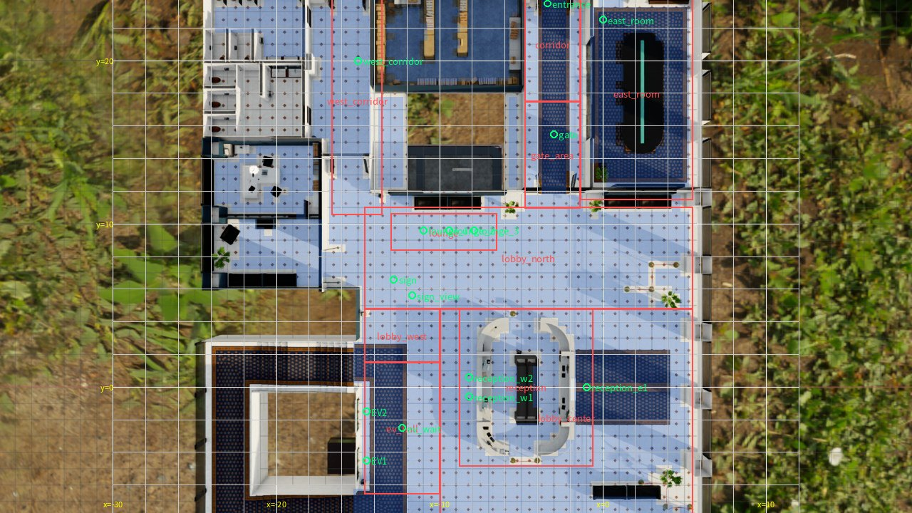

# JSON の設定のチュートリアル

[English](config-tutorial.en.md) ｜ **チュートリアル** ｜ [リファレンス](config-reference.md) ｜ [Python の使い方](library.md) ｜ [コードの例](../examples/README.md)

JSON の設定ファイルを 1 つ書き、少しずつ足しながら、twinsim でできることを順に試します。上から読むと、人の流れ、カメラ、エレベーター、動画までの書き方が分かります。
キーの一覧を調べたいときは[リファレンス](config-reference.md)を見てください。

## 目次

1. [準備と実行の仕方](#setup)
2. [いちばん小さい設定](#first)
3. [人の量を変える](#amount)
4. [行き先を分ける](#destinations)
5. [途中で止まる](#stops)
6. [人の現れる場所を変える](#origin)
7. [カメラを置いて正解ラベルを出す](#cameras)
8. [文献の値を使う](#literature)
9. [エレベーターを動かす](#elevator)
10. [動画にする](#video)
11. [条件を比べる](#compare)
12. [誤りを読む](#errors)
13. [次に読むもの](#next)

<a id="setup"></a>

## 1. 準備と実行の仕方

入れ方は [README](../README.md) にあります。このページのコマンドは、リポジトリの中で実行するなら頭に `uv run` を付けます。

設定を `config.json` に書いたら、次の順に実行します。

```bash
twinsim validate config.json               # 設定を確かめる（計算はしない）
twinsim run config.json --out runs/first   # 計算する（CPU だけ、数秒）
```

Python から呼ぶこともできます。

```python
import twinsim

result = twinsim.simulate("config.json", out_dir="runs/first")
print(result.summary["people"], "人")
```

結果は `runs/first/` に書かれます。まず見るのは次の 2 つです。

| ファイル | 中身 |
|---|---|
| `summary.json` | 人数、同時に最大の人数、流れごとの人数などの要約 |
| `preview.png` | 真上の図に人の軌跡を重ねた図 |

<a id="first"></a>

## 2. いちばん小さい設定

オフィスの入口から南の出口へ、人が歩くだけの設定です。必須のキーは `space` だけで、人を出すには `streams` も書きます。

```json
{
  "name": "tutorial",
  "space": "office",
  "duration_s": 60,
  "streams": [
    {
      "name": "commuters",
      "origin": "entrance",
      "rate": 20,
      "destinations": ["south_exit"]
    }
  ]
}
```

- `space`: 空間の名前です。一覧は `twinsim spaces` で出ます。
- `duration_s`: 計算する長さ（秒）です。
- `streams`: 人の流れの一覧です。
- `origin`: 人が現れる場所です。
- `rate`: 1 分あたりの到着の数です。毎回同じ数ではなく、平均がこの値になるように乱数で決まります。
- `destinations`: 行き先です。

`entrance` や `south_exit` のような名前は、空間ごとに決まっています。一覧は[リファレンス](config-reference.md#places)にあります。

→ リファレンス: [`streams[]`](config-reference.md#streams)

<a id="amount"></a>

## 3. 人の量を変える

ここからは、前の節の設定の一部だけを示します。示したキーを、そのまま置き換えてください。

時間で人の量を変えるには、`rate` を `piecewise` にします。`[秒, 率]` の組を並べると、その間は線でつながります。次の例は、30 秒の時点がいちばん混みます。

```json
"streams": [
  {
    "name": "commuters",
    "origin": "entrance",
    "rate": {"type": "piecewise", "per_min": [[0, 5], [30, 30], [60, 5]], "unit": "persons"},
    "group_size": {"type": "zero_truncated_poisson", "lam": 0.2},
    "destinations": ["south_exit"]
  }
]
```

- `unit: "persons"`: 率を人/分で数えます。書かなければ、グループの数/分です。
- `group_size`: 一緒に歩く人数の分布です。`lam` を大きくすると、グループが増えます。

→ リファレンス: [`rate`](config-reference.md#rate)、[分布の書き方](config-reference.md#distributions)

<a id="destinations"></a>

## 4. 行き先を分ける

行き先を複数書くと、`p` の重みで選ばれます。`via` には途中で通るゲートを書きます。

```json
"streams": [
  {
    "name": "commuters",
    "origin": "entrance",
    "rate": 20,
    "destinations": [
      {"to": "south_exit", "p": 0.7, "via": ["gate"]},
      {"to": "west_corridor", "p": 0.2},
      {"to": "east_room", "p": 0.1}
    ]
  }
]
```

重みの合計は 1 でなくてもかまいません。

→ リファレンス: [`destinations[]`](config-reference.md#destinations)

<a id="stops"></a>

## 5. 途中で止まる

`to` に止まる場所を書くと、人はそこで止まります。`dwell` が止まる時間で、`then` が次の行き先です。`reception` のように名前の頭だけを書くと、`reception_w1` などのどれかが選ばれます。

人の種類を分けて、種類ごとに行き先を変えることもできます。

```json
"streams": [
  {
    "name": "staff",
    "origin": "entrance",
    "rate": 15,
    "types": "staff",
    "destinations": [{"to": "south_exit", "via": ["gate"]}]
  },
  {
    "name": "visitors",
    "origin": "entrance",
    "rate": 4,
    "types": "visitor",
    "destinations": [
      {
        "to": "reception",
        "via": ["gate"],
        "dwell": {"type": "lognormal", "median": 25, "sigma": 0.4, "min": 8, "max": 90},
        "then": "south_exit"
      }
    ]
  }
]
```

→ リファレンス: [`destinations[]`](config-reference.md#destinations)、[場所の名前](config-reference.md#places)

<a id="origin"></a>

## 6. 人の現れる場所を変える

`origin` には、場所の名前の代わりに座標を書けます。座標は世界の座標（m）です。下の図の青い所が歩ける所で、格子の線は 2 m ごとです。



*オフィスの 1 階。緑が場所の名前、赤がゾーン。`twinsim show-space office` で作った図。素材: NVIDIA Isaac Sim（CC BY 4.0）*

点から現れる流れと、線の上のどこかから現れる流れを書きます。線は、幅のある入口を表すときに使います。

```json
"streams": [
  {
    "name": "from_point",
    "origin": {"xy": [-3.0, 20.0]},
    "rate": 10,
    "destinations": ["south_exit"]
  },
  {
    "name": "from_door",
    "origin": {"line": [[-4.0, 20.0], [-2.0, 20.0]], "name": "north_door"},
    "rate": 10,
    "destinations": ["south_exit"]
  }
]
```

`origin` の `name` は集計での呼び名です。書かなければ流れの名前を使います。

歩ける所の外の座標や、行き先まで歩いて行けない座標は、計算の前にエラーになります。エラーの文には近くの歩ける所が出ます。

GUI なら、図の緑の四角をドラッグして動かせます。図の上にマウスを置くと、その点の座標も出ます。

→ リファレンス: [`origin`](config-reference.md#origin)

<a id="cameras"></a>

## 7. カメラを置いて正解ラベルを出す

`cameras` を書くと、カメラごとの人の枠（検出と追跡の正解ラベル）が `mot/<カメラ>.txt` に出ます。空間の候補の名前を書くか、位置を自分で決めます。

```json
"cameras": [
  {"name": "CamGate"},
  {"name": "CamEV", "focal_mm": 10.0},
  {"name": "MyCam", "eye": [-6.0, 6.0, 2.7], "target": [-3.0, 14.5, 0.8]}
]
```

- `CamGate`: 空間の候補をそのまま使います。
- `CamEV`: 候補の焦点距離だけを変えます。
- `MyCam`: 新しいカメラです。`eye`（位置）と `target`（見る点）が必須です。どちらも `[x, y, z]` で、`z` は高さ（m）です。

ラベルは Python から読めます。列は `frame, id, x, y, w, h, conf, class, visibility` です。

```python
labels = result.mot("MyCam")
print(len(labels), "個の枠")
```

→ リファレンス: [`cameras[]`](config-reference.md#cameras)、[コードの例 03](../examples/03_read_labels.py)

<a id="literature"></a>

## 8. 文献の値を使う

`people.profile` を書くと、歩く速さやグループの大きさに文献の値の組が入ります。`demand` には建物の人数を書くと、EV を使う人の量を文献の割合から計算できます。

```json
"people": {"profile": "office_commute_jp"},
"demand": {"population": 600, "period": "morning", "peak_pct_5min": 12},
"streams": [
  {
    "name": "commuters",
    "origin": "entrance",
    "rate": {"type": "lift_demand", "flow": "incoming", "share": 0.9},
    "destinations": [{"to": "south_exit", "via": ["gate"]}]
  }
]
```

`share` は、計算した量のうちこの流れの割合です。計算のたびに `validity.md` が書かれ、値ごとの根拠と、結果を文献と比べた表を読めます。

→ リファレンス: [`people`](config-reference.md#people)、[`demand`](config-reference.md#demand)、[文献の値の根拠](validity.md)

<a id="elevator"></a>

## 9. エレベーターを動かす

行き先に `elevator` を書くと、人は EV の前で待って乗ります。この行き先を使うときは、`elevator` の設定が必要です。

```json
"streams": [
  {
    "name": "commuters",
    "origin": "entrance",
    "rate": 15,
    "destinations": [{"to": "elevator", "via": ["gate"]}]
  }
],
"elevator": {
  "cars": ["EV1", "EV2"],
  "capacity": 8,
  "schedule": {"type": "interval", "interval": {"type": "uniform", "min": 35, "max": 60}},
  "alight": {"count": {"type": "poisson", "lam": 1.0}, "destinations": ["south_exit"]}
}
```

- `cars`: 使う EV の扉の名前です。
- `schedule`: EV が着く時刻の決め方です。ここでは、号機ごとに 35〜60 秒の間隔で着きます。
- `alight`: 着いたときに降りる人です。

自分の運行のルールをコードで差し込むこともできます（[EV の運行を差し替える](library.md)）。

→ リファレンス: [`elevator`](config-reference.md#elevator)

<a id="video"></a>

## 10. 動画にする

ここまでの計算では動画はできません。動画は、計算の結果を Isaac Sim で描画して作ります。GPU を使います。設定には描画の大きさや、人ごとに服の色を変えるかどうかを書きます。

```json
"cameras": [{"name": "CamGate"}],
"render": {"width": 1280, "height": 720, "tint": false}
```

描画は設定とは別の操作です。設定を変えたら、計算し直してから描きます。

```bash
twinsim run config.json --out runs/first       # 計算し直す（CPU）
./isaac_up.sh                                  # Isaac Sim を起動する（1 分ほど待つ）
twinsim render runs/first --frames 300 449     # 300〜449 コマ目を描く
isim down                                      # 終わったら GPU を返す
```

動画は `runs/first/video/<カメラ>.mp4` にできます。全部の長さを描くと、1 台あたり映像の長さの約 8.5 倍かかります。まず短い区間で確かめてください。

→ リファレンス: [`render`](config-reference.md#render)、[コードの例 04](../examples/04_get_video.py)

<a id="compare"></a>

## 11. 条件を比べる

同じ設定と `seed` なら、結果は同じになります。乱数の影響を見るには、`seed` を変えて何回か計算します。

```bash
twinsim run config.json --out runs/s1 --set seed=1
twinsim run config.json --out runs/s2 --set seed=2
```

`--set` はキーを `.` でつないで書けます（`--set people.lateral_max_m=0.8`）。配列の中を番号で指定できるのは `streams` だけです（`--set streams.0.rate=30`）。

2 つの条件を比べるには、`variants` を使います。行き先の `variant_p` に名前を付けると、その重みを条件ごとに差し替えます。

```json
"variant": "A",
"variants": {"A": {"sign": 0.05}, "B": {"sign": 0.30}},
"streams": [
  {
    "name": "visitors",
    "origin": "entrance",
    "rate": 10,
    "destinations": [
      {"to": "sign", "p": 0.05, "variant_p": "sign", "dwell": 5, "then": "south_exit"},
      {"to": "south_exit", "p": 0.95}
    ]
  }
]
```

`--set variant=B` で B の条件になります。

→ リファレンス: [`variants`](config-reference.md#variants)

<a id="errors"></a>

## 12. 誤りを読む

知らないキーは、計算の前にエラーになります。綴りの誤りが、既定の値のまま黙って動くことはありません。

```text
$ twinsim validate config.json
シナリオの誤り:
  知らないキー duraton_s（使えるのは calibration, cameras, ...）
  streams[0].destinations[0]: 行き先 south_exit2 が空間 office にない
```

誤りは 1 回で全部出ます。同じ場所に計算し直すと、前の結果は置き換わります。`streams[0].destinations[0]` は、1 番目の流れの 1 番目の行き先を指します。番号は 0 から数えます。

検査の一覧は[リファレンス](config-reference.md#checks)にあります。

<a id="next"></a>

## 13. 次に読むもの

| 読むもの | 中身 |
|---|---|
| [リファレンス](config-reference.md) | 全部のキー、既定の値、場所の名前 |
| [コードの例](../examples/README.md) | 動画の取得、枠の重ね合わせ、学習データの作成 |
| [Python の使い方](library.md) | 関数、`Result`、GUI との対応 |
| [出力の形](formats.md) | 書き出すファイルの列と意味 |

テンプレートから始めることもできます。

```bash
twinsim templates                                 # テンプレートの一覧
twinsim template office_gate_ev --out config.json # ひな形を書き出す
```

---

[English](config-tutorial.en.md) ｜ **チュートリアル** ｜ [リファレンス](config-reference.md)
