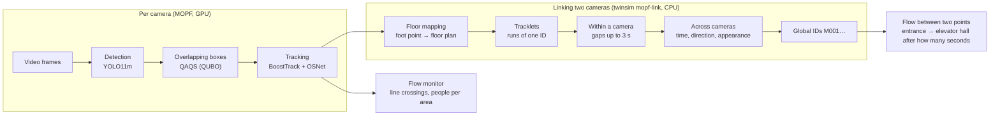
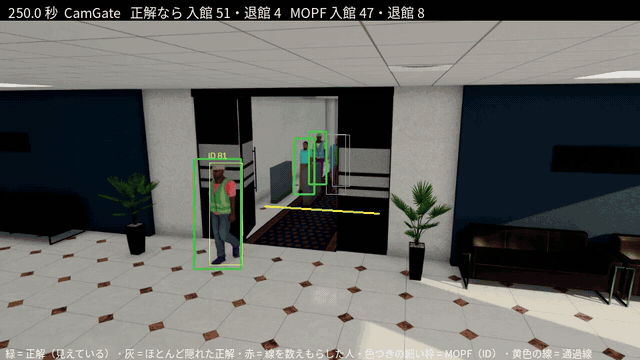
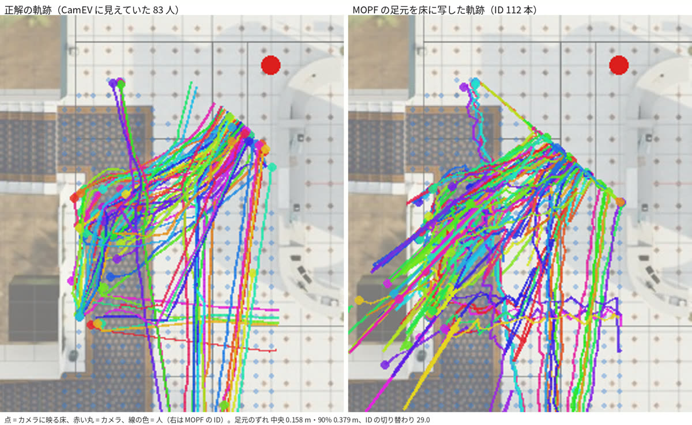
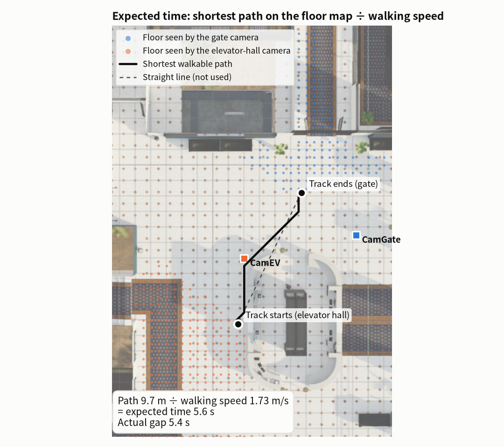
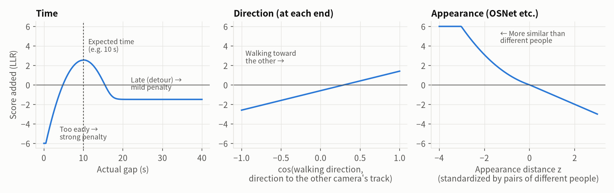
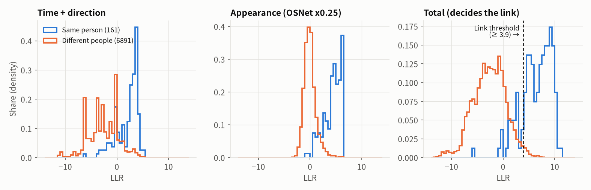
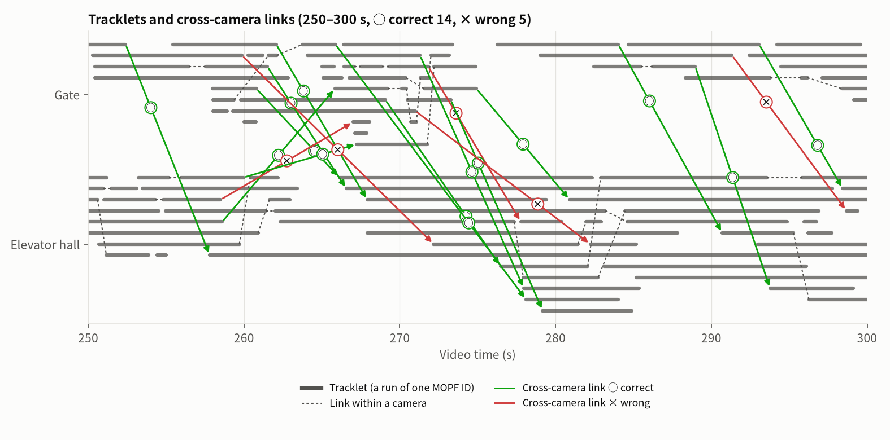
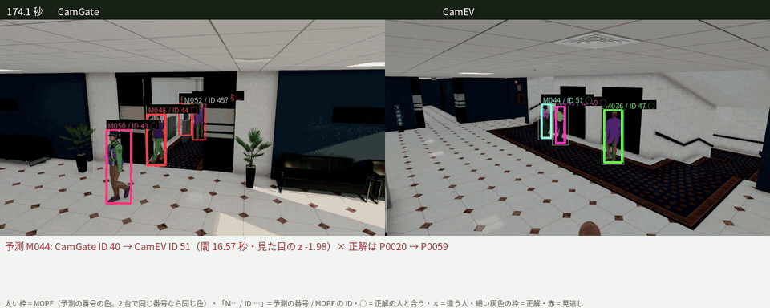

# How detection and two-point linking work

[日本語](methods.md)

This page explains the methods from finding and tracking people in surveillance video (MOPF) to linking the same person across two cameras (twinsim `mopf-link`).
Figures and numbers come from the twinsim scene `office_gate_ev` (office lobby, the busiest 5 morning minutes, 94 people, two cameras: gate and elevator hall), made with [tools/method_figures.py](../tools/method_figures.py).
For all results see the [progress report](report/2026-10-24/README.en.md); for the integration procedure see [integration.en.md](integration.en.md).

## 1. Overall flow

| Stage | Method | Runs in | Time per camera, 5 min |
|---|---|---|---|
| Detection | YOLO11m (pretrained on COCO, people only) | MOPF (GPU) | about 3 min (detection through tracking) |
| Overlapping boxes | QAQS: choose which boxes to keep with a QUBO (NMS for comparison) | MOPF (GPU, Gurobi) | same |
| Tracking | BoostTrack (motion + re-identification with OSNet x0.25) | MOPF (GPU) | same |
| Floor mapping | Image → floor homography (foot point) | twinsim (CPU) | about 1 s |
| Linking two cameras | Log-likelihood ratios (time, direction, appearance) + Hungarian method | twinsim (CPU) | about 30 s (including appearance features) |

## 2. Detection: YOLO11m

Each frame gives person (COCO "person") boxes with confidences; boxes with confidence ≥ 0.5 are kept. With QAQS, the NMS inside YOLO is turned off (IoU 1.0) and overlapping boxes are handled in the next stage.

Gate camera. Green = ground truth, thin colored boxes = MOPF, yellow line = counting line, red = people whose crossing was missed.

## 3. Overlapping boxes: NMS and QAQS

A detector outputs several boxes for the same person, which must be reduced to one.

- **NMS** (the usual method): keep boxes in order of confidence and remove boxes whose IoU (overlap ratio) with a kept box exceeds a threshold. In dense queues it also removes the boxes of people standing behind others.
- **QAQS** (MOPF default): choose which candidate boxes of a frame to keep with a QUBO (minimizing a quadratic function of 0/1 variables). $x_i = 1$ means "keep box $i$".

$$
\min_{x \in \{0,1\}^n} \; -w_1 \sum_i c_i x_i \;+\; \sum_{i<j} \left( w_2\, \mathrm{IoU}_{ij} + w_3\, O_{ij} \right) S_{ij}\, x_i x_j
$$

| Symbol | Meaning | Value |
|---|---|---|
| $c_i$ | Box confidence | from YOLO |
| $\mathrm{IoU}_{ij}$ | IoU of the two boxes | |
| $O_{ij}$ | Overlap = intersection ÷ $\sqrt{\text{area}_i \cdot \text{area}_j}$ (large also when a small box lies inside a large one) | |
| $S_{ij}$ | Image similarity inside the two boxes (SSIM, resized to 48×48) | |
| $w_1, w_2, w_3$ | Weights | 0.2, 0.2, 0.6 |

- Boxes that overlap **and look alike** (duplicates of one person) are penalized strongly; boxes that overlap but **look different** (a person in front and another behind) tend to survive.
- Solving: a pre-filter applies NMS with IoU 0.3 and keeps the top 40 candidates, then Gurobi solves the QUBO exactly (MOPF_CV_Native `qubo_suppression.py`, defaults).
- The pre-filter IoU of 0.3 is stricter than usual NMS (e.g. 0.7). In dense scenes, people behind others may already be removed at this step (not verified).
  In a dense waiting scene of the virtual hospital, QAQS with default settings had lower recall than NMS with IoU 0.7 (0.632 vs 0.677; preliminary experiment in the research folder; not tuned for that scene).

## 4. Tracking: BoostTrack

Boxes are linked across frames and given per-camera IDs (tracking-by-detection). MOPF uses BoostTrack from boxmot (camera-motion compensation is off because the cameras are fixed).

- Motion: a Kalman filter predicts the next position; predictions are matched to detections by IoU, Mahalanobis distance and shape similarity.
- Appearance: similarity of re-identification features from OSNet x0.25 (trained on MSMT17) is added (fewer swaps when people overlap).
- Low-confidence detections are used when they agree well with a prediction (BoostTrack's confidence boosting).

| Camera | MOTA | IDF1 | ID switches (5 min) | Recall | Precision |
|---|---|---|---|---|---|
| Gate | 0.868 | 0.859 | 29 | 0.893 | 0.975 |
| Elevator hall | 0.898 | 0.878 | 29 | 0.964 | 0.936 |

An ID switch is when one person's ID changes midway or two people swap IDs. The linking stage is built to cope with them (7.2).

## 5. Flow monitor (line crossings, people per area)

MOPF's flow monitor counts, per direction, when the bottom center of a box (the foot point) crosses a counting line (no direction is decided within 8 pixels of the line).
People per area is the number of IDs whose foot point is inside the area polygon. twinsim draws the counting line 1 m from the gate in the entry direction
(people already past the line when they appear from behind the door cannot be counted; the share of entries counted went from 72% to 91%).

## 6. Floor mapping

The foot point is mapped to floor-plan coordinates (m) by an image → floor homography (3×3), computed from at least four point correspondences between the floor and the image
(twinsim uses the camera model; for real cameras, points are picked on the floor plan and the camera image). The foot-point error is 0.16–0.22 m at the median (the bottom edge of a box is the front edge of the body, so it is slightly off).

Left: ground-truth trajectories; right: MOPF foot points mapped onto the floor (elevator-hall camera).

## 7. Linking the same person across two cameras (mopf-link)

MOPF IDs are per camera, so we cannot tell whether gate ID 12 and elevator-hall ID 10 are the same person. The fields of view do not overlap, so we score
**"did someone who looks alike appear at the expected time, from the expected direction?"** and link on that. The ground truth is not used (only for scoring at the end).

### 7.1 Tracklets

A run of one MOPF ID. Runs are split at gaps longer than 0.5 s, and runs shorter than 10 frames are dropped. Each tracklet keeps its start and end positions on the floor,
the walking direction there, its walking speed and an appearance feature (from 8 crops; people shorter than 50 pixels are not used).

### 7.2 Linking within a camera

In the same camera, tracklets starting within 3 s after another ends are candidates, scored by the error against the predicted position (end position + velocity × gap) and by appearance.
This joins tracks of the same person split by ID switches into "camera tracks".

### 7.3 Linking across cameras: three cues

Candidates: the end of a camera track → the start of a camera track in another camera (within 90 s; it may start up to 1 s earlier because of overlap at the view edges).
Each cue is turned into a **log-likelihood ratio (LLR) of "same person" versus "different people"**, and the LLRs are added. A larger LLR means more likely the same person. Each cue adds at most ±6.

**Time**: compare the gap with the "expected time" = the shortest path on the walkable floor (Dijkstra on a grid) from the end position to the start position, divided by the walking speed. The path length, not the straight-line distance, is used.

<picture>
  <source media="(prefers-color-scheme: dark)" srcset="img/methods/path_en_dark.png">
  
</picture>

- Same person: 80% a normal distribution around the expected time (width 0.8 + 0.15 × expected time, in s), 20% delayed by detours (reception, meeting someone; uniform from the expected time to 91 s).
- Different people: uniform over the 91-s window.
- Learned time (`time*`): from confident pairs of a first pass (margin ≥ 2, appearance z ≤ −2), the distribution of the deviation from the expected time is learned per camera pair (kernel density estimate, when there are at least 10 pairs)
  and used in a second pass. In this scene, gate → elevator hall was learned to be 1.3 s earlier than the map-based estimate at the median.

**Direction**: whether the walking direction at the end of a track points toward the other track's start, and whether the walking direction at the start comes from the other track (each end, von Mises distribution, concentration 2).

$$
\mathrm{LLR}_\text{direction} = \log\frac{\kappa}{\sinh \kappa} + \kappa \cos\theta, \quad \kappa = 2
$$

**Appearance**: the distance $d$ between re-identification features (default OSNet x0.25, the same weights as MOPF) is standardized by the distances between **two people seen at the same time in the same camera (always different people)**
($z = (d - \mu)/\sigma$; this gives the "different people" distribution without ground truth). The more similar than different people ($z < 0$), the larger the LLR ($-\log(2\Phi(z))$); otherwise $-z$.

<picture>
  <source media="(prefers-color-scheme: dark)" srcset="img/methods/cues_en_dark.png">
  
</picture>

### 7.4 Deciding the links

$$
\text{cost} = -\left(\mathrm{LLR}_\text{time} + \mathrm{LLR}_\text{direction} + \mathrm{LLR}_\text{appearance} + \log\frac{0.5}{k}\right)
$$

- $\log(0.5/k)$ is the prior log-odds, where $k$ is the mean number of candidates per end; more candidates make the threshold stricter (about −3.9 in this scene, i.e. only pairs with LLR ≥ 3.9 can be linked).
- Only pairs with cost ≤ 0 are chosen, at most one per end (Hungarian method).
- Alternative `hc:` (hierarchical clustering): average-linkage clustering over the scores of all pairs, with the constraint that tracks overlapping in time in the same camera are never joined (the idea of top methods in AI City Challenge 2024).
- Following the links gives global IDs (M001…).

Score distributions over tracklet pairs (7,052 pairs, 161 of them the same person). Time + direction alone and appearance alone overlap, but together they separate.
Pairs of different people are more than 40 times as many, so the prior log-odds make the threshold strict.

<picture>
  <source media="(prefers-color-scheme: dark)" srcset="img/methods/separation_en_dark.png">
  
</picture>

### 7.5 Inference results

Tracklets of the two cameras (gray bars) and the inferred cross-camera links (arrows; ○ correct, × wrong). Errors gather in the crowded queue near the end.

<picture>
  <source media="(prefers-color-scheme: dark)" srcset="img/methods/timeline_en_dark.png">
  
</picture>

The two cameras side by side with predicted global IDs (thick box color = ID; the same ID has the same color in both cameras; ○ = matches the ground-truth person, × = a different person):

Scoring: MOPF boxes and ground-truth boxes are matched per frame (IoU ≥ 0.3) to decide each tracklet's person (the majority in its last and first second).
A cross-camera link is correct if the person at the end of the earlier tracklet equals the person at the start of the later one. The IDF1 over both cameras follows AI City MTMC.

| Method | IDF1 over both cameras | Correct links / predicted links (78 true transitions) |
|---|---|---|
| No linking | 0.589 | - |
| Time + direction only | 0.617 | 5 / 23 |
| Learned time + OSNet x0.25 (default) | 0.802 | 69 / 79 |
| Learned time + CLIP-ReID ViT-B/16 | 0.806 | 68 / 77 |
| Learned time + clothing color, hierarchical clustering | 0.845 | 71 / 73 |

Time alone cannot link (about 11 people pass per minute, so several people fit the expected time). Appearance is the main cue; time and direction narrow down the candidates.

### 7.6 Limitations

- The rendering gives each person a different clothing tint, so appearance (especially clothing color) is too strong here. In real video, people wear similar clothes and appearance will be a weaker cue.
- The prior (0.5), the detour share (0.2) and the direction concentration (2) are provisional. Changing them moves IDF1 between 0.77 and 0.83.
- Only two cameras. With more cameras the combinations grow and contradictions (A = B, B = C but A ≠ C) must be resolved globally (hierarchical clustering or a QUBO).
- In crowded queues, ID switches within a camera turn directly into cross-camera errors (near the end in 7.5).

## 8. Where the code is

| Stage | Code | Command |
|---|---|---|
| Detection, overlaps, tracking | MOPF_CV_Native `ml_tools/detection.py`, `qubo_suppression.py` (QAQS), `tracking.py` (BoostTrack) | `./run.sh mopf-process <run>` |
| Comparison with ground truth | [twinsim/mopf/evaluate.py](../twinsim/mopf/evaluate.py), [crossings.py](../twinsim/mopf/crossings.py) | `./run.sh mopf-eval <run>` |
| Floor mapping | [twinsim/mopf/floormap.py](../twinsim/mopf/floormap.py), [monitor.py](../twinsim/mopf/monitor.py) (homography) | "Floor map" in the GUI |
| Linking two cameras | [twinsim/mopf/linking.py](../twinsim/mopf/linking.py), [twinsim/reid.py](../twinsim/reid.py) (OSNet, CLIP-ReID) | `./run.sh mopf-link <run>` |
| Side-by-side in time | [twinsim/mopf/identity.py](../twinsim/mopf/identity.py) | `./run.sh mopf-sync <run>` |
| Figures on this page | [tools/method_figures.py](../tools/method_figures.py) | `uv run python tools/method_figures.py` |

References: YOLO11 (Ultralytics); BoostTrack (Stanojević & Todorović, 2024; boxmot implementation, used inside MOPF, not included in twinsim);
OSNet (Zhou et al., 2019, torchreid); CLIP-ReID (Li et al., 2023); AI City Challenge MTMC evaluation.
