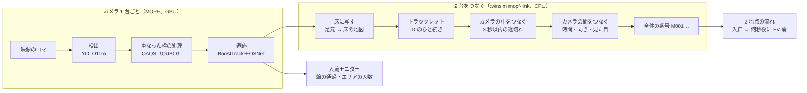
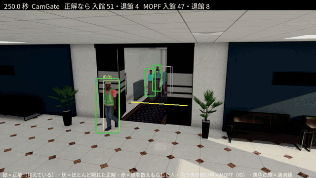
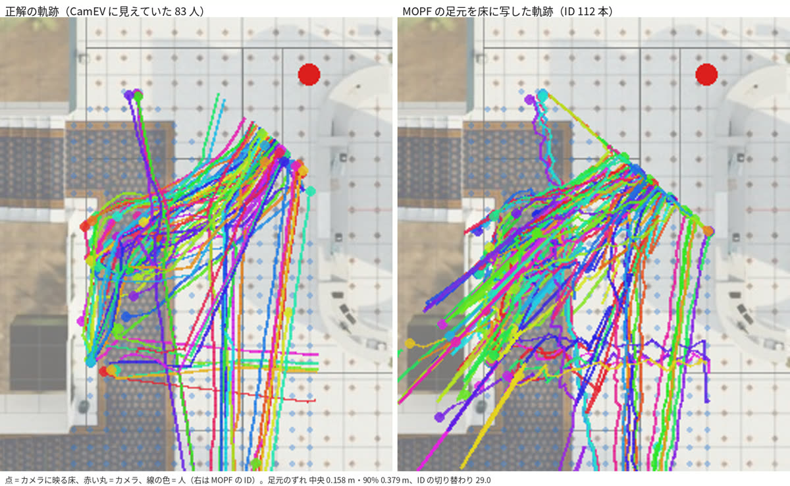
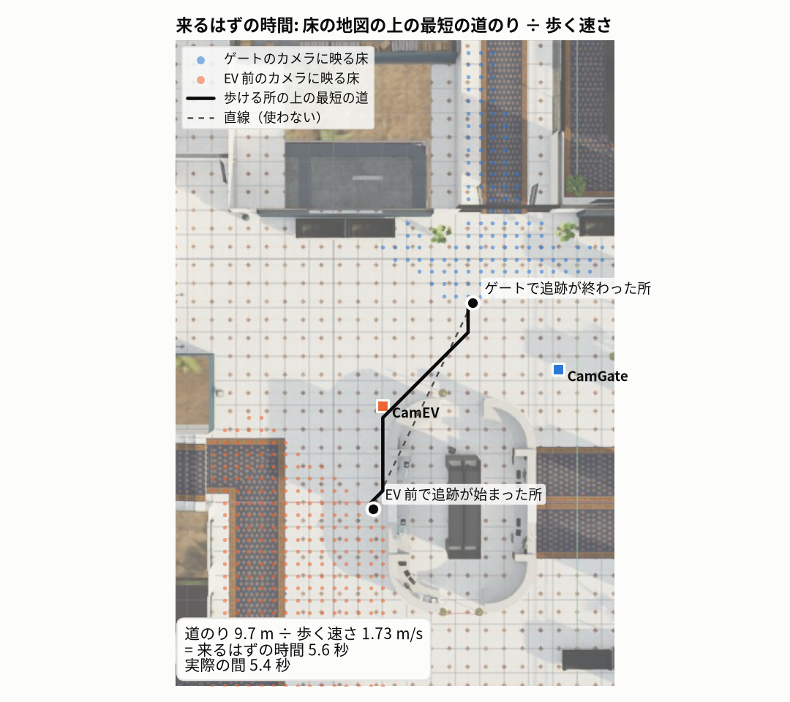
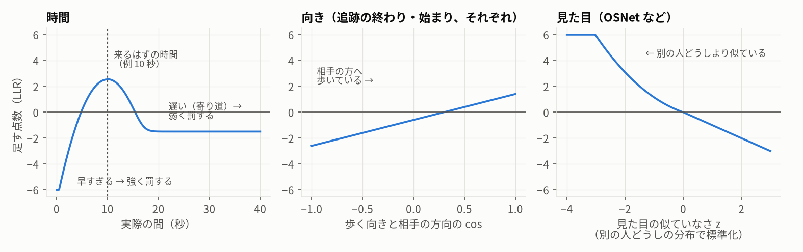
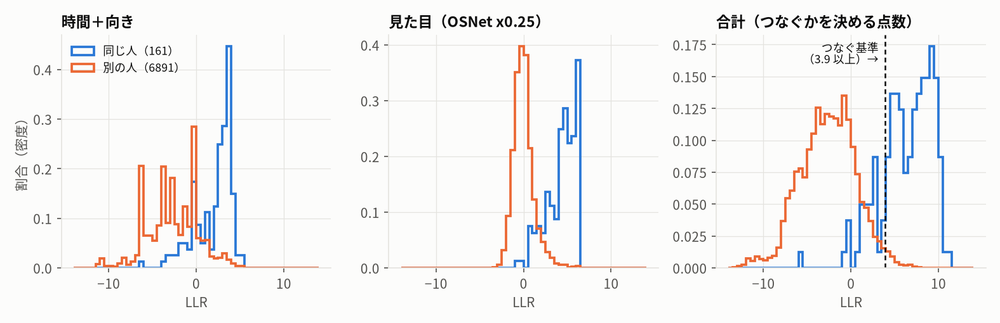
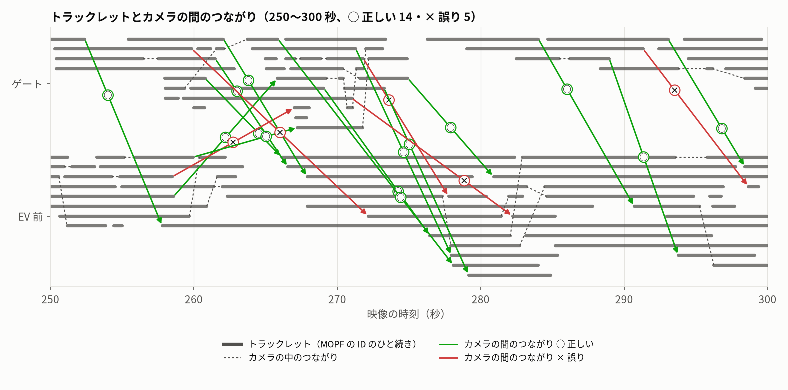
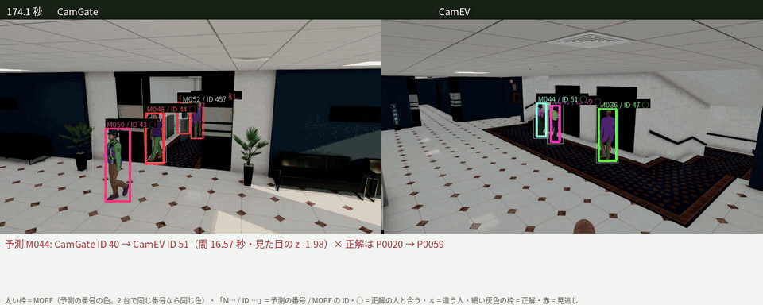

# 検知と 2 地点の紐付けの仕組み

[English](methods.en.md)

監視カメラの映像から人を見つけて追い（MOPF）、2 台のカメラの間で同じ人をつなぐ（twinsim の `mopf-link`）までの手法の説明。
図と数字は twinsim の場面 `office_gate_ev`（オフィスのロビー、朝の混む 5 分、94 人、ゲートと EV 前のカメラ 2 台）から作った（[tools/method_figures.py](../tools/method_figures.py)）。
結果の全体は [進捗の報告](report/2026-10-24/README.md)、連携の手順は [integration.md](integration.md)。

## 1. 全体の流れ

| 段 | 手法 | 動く所 | 1 台・5 分の処理 |
|---|---|---|---|
| 検出 | YOLO11m（COCO で学習済み、人だけ） | MOPF（GPU） | 約 3 分（検出〜追跡まで） |
| 重なった枠の処理 | QAQS: 残す枠の組み合わせを QUBO で選ぶ（比べるときは NMS） | MOPF（GPU・Gurobi） | 同上 |
| 追跡 | BoostTrack（動き＋人物照合 OSNet x0.25） | MOPF（GPU） | 同上 |
| 床に写す | 画像 → 床の射影変換（足元の点） | twinsim（CPU） | 1 秒ほど |
| 2 台をつなぐ | 対数尤度比（時間・向き・見た目）＋ハンガリー法 | twinsim（CPU） | 約 30 秒（見た目の特徴を含む） |

## 2. 検出: YOLO11m

各コマで人（COCO の person）の枠と確からしさを出す。確からしさ 0.5 以上を残す。QAQS を使うときは YOLO の中の NMS を切り（IoU 1.0）、重なった枠の処理を次の段に任せる。

ゲートのカメラ。緑 = 正解、色つきの細い枠 = MOPF、黄色の線 = 通過線、赤 = 線を数えもらした人。

## 3. 重なった枠の処理: NMS と QAQS

検出器は同じ人に何枚も枠を出すので、1 枚に減らす。

- **NMS**（ふつうの方法）: 確からしさの高い順に残し、それと IoU（重なりの割合）がしきい値を超える枠を消す。密集した列では、手前の人の枠と重なる奥の人の枠まで消してしまう。
- **QAQS**（MOPF の既定）: 1 コマの候補の枠から、残す組み合わせを QUBO（0/1 の変数の 2 次の最小化）で選ぶ。$x_i = 1$ が「枠 $i$ を残す」。

$$
\min_{x \in \{0,1\}^n} \; -w_1 \sum_i c_i x_i \;+\; \sum_{i<j} \left( w_2\, \mathrm{IoU}_{ij} + w_3\, O_{ij} \right) S_{ij}\, x_i x_j
$$

| 記号 | 意味 | 値 |
|---|---|---|
| $c_i$ | 枠の確からしさ | YOLO の出力 |
| $\mathrm{IoU}_{ij}$ | 2 枚の枠の IoU | |
| $O_{ij}$ | 重なり = 共通部分 ÷ $\sqrt{\text{面積}_i \cdot \text{面積}_j}$（小さい枠が大きい枠に含まれても大きくなる） | |
| $S_{ij}$ | 2 枚の枠の中の画像の似かた（SSIM、48×48 に縮めて） | |
| $w_1, w_2, w_3$ | 重み | 0.2・0.2・0.6 |

- 重なっていて**見た目も似ている**枠（同じ人の重複）を強く罰し、重なっていても**見た目が違う**枠（手前と奥の別の人）は残りやすくする。
- 解き方: 前処理で IoU 0.3 の NMS をかけて候補を上位 40 に絞り、Gurobi で厳密に解く（MOPF_CV_Native の `qubo_suppression.py`、既定）。
- 前処理の IoU 0.3 は、ふつうの NMS（0.7 など）より厳しい。密集した場面では、この段階で奥の人が消えている可能性がある（確かめていない）。
  仮想病院の密集した待ちの場面では、既定の設定の QAQS の再現率は NMS（IoU 0.7）より低かった（0.632 と 0.677。研究のフォルダの予備実験。この場面向けの調整はしていない）。

## 4. 追跡: BoostTrack

コマごとの枠をつないで、カメラごとに ID を付ける（tracking-by-detection）。MOPF は boxmot の BoostTrack を使う（カメラは動かないので画面の動きの補正は切る）。

- 動き: カルマンフィルタで次のコマの位置を予測し、検出の枠との IoU・マハラノビス距離・形の似かたで対応づける。
- 見た目: 人物照合のモデル OSNet x0.25（MSMT17 で学習）の特徴の似かたも足す（人が重なっても取り違えにくい）。
- 確からしさの低い検出も、予測とよく合えば使う（BoostTrack の「確からしさの底上げ」）。

| カメラ | MOTA | IDF1 | ID の切り替わり（5 分） | 再現率 | 適合率 |
|---|---|---|---|---|---|
| ゲート | 0.868 | 0.859 | 29 | 0.893 | 0.975 |
| EV 前 | 0.898 | 0.878 | 29 | 0.964 | 0.936 |

ID の切り替わり = 同じ人の ID が途中で変わる・2 人の ID が入れ替わること。2 台をつなぐ段は、これを前提に作る（7.2）。

## 5. 人流モニター（線の通過・エリアの人数）

MOPF の人流モニターは、枠の下の真ん中（足元）が通過線を横切ったら、向きごとに数える（線から 8 画素以内は向きを決めない）。
エリアの人数は足元がエリアの多角形の中にある ID の数。twinsim では通過線をゲートから入館の向きに 1 m ずらして引く
（扉の陰から現れた時点で線を越えていると数えられないため。入館を数えられる割合 72% → 91%）。

## 6. 床に写す

足元の点を、画像 → 床の射影変換（3×3）で床の地図の座標（m）にする。射影変換は、床の上の点と画像の上の点の 4 組以上の対応から求める
（twinsim ではカメラの模型から、実際のカメラでは床の図とカメラの画像で点を選ぶ）。足元のずれは中央 0.16〜0.22 m（枠の下の端は体の手前の端なので少しずれる）。

左: 正解の軌跡、右: MOPF の足元を床に写した軌跡（EV 前のカメラ）。

## 7. 2 台の間で同じ人をつなぐ（mopf-link）

MOPF の ID はカメラごとなので、ゲートの ID 12 と EV 前の ID 10 が同じ人かは分からない。視野は重ならないので、
**「来るはずの時間に、来るはずの向きから、似た見た目の人が現れたか」**を点数にしてつなぐ。正解は使わない（最後の採点にだけ使う）。

### 7.1 トラックレット

MOPF の 1 つの ID のひと続き。0.5 秒より長い途切れで分け、10 コマより短いものは使わない。トラックレットごとに、
床の上の始まり・終わりの位置、その時の歩く向き、歩く速さ、見た目の特徴（8 枚の切り出しから。背の高さ 50 画素未満の人は使わない）を持つ。

### 7.2 カメラの中をつなぐ

同じカメラで、あるトラックレットの終わりから 3 秒以内に始まるトラックレットを候補にし、位置の予測（終わりの位置＋速度 × 間）とのずれと、見た目で点数を付ける。
ID の切り替わりで切れた同じ人の追跡をつなぎ、「カメラの追跡」にする。

### 7.3 カメラの間をつなぐ: 3 つの手がかり

候補: あるカメラの追跡の終わり → 別のカメラの追跡の始まり（90 秒以内。視野の端の重なりのため 1 秒前に始まってもよい）。
それぞれの手がかりを、**「同じ人」と「別の人」の尤もらしさの比の対数（LLR）**にして足す。LLR が大きいほど同じ人らしい。1 つの手がかりで足す LLR は ±6 まで。

**時間**: 終わりの位置から始まりの位置まで、床の歩ける所の上の最短の道のり（格子の上のダイクストラ法）を、歩く速さで割った「来るはずの時間」と比べる。直線ではなく道のりを使う。

<picture>
  <source media="(prefers-color-scheme: dark)" srcset="img/methods/path_ja_dark.png">
  
</picture>

- 同じ人の分布: 来るはずの時間のまわりの正規分布（幅 0.8 ＋ 0.15 × 来るはずの時間 秒）が 8 割、寄り道（受付・待ち合わせ）で遅れるのが 2 割（来るはずの時間から 91 秒まで一様）。
- 別の人の分布: 91 秒の窓の中で一様。
- 時間の学習（`time*`）: 1 回目の推論の確からしい組（余裕 2 以上・見た目の z が −2 以下）から、来るはずの時間とのずれの分布をカメラの組ごとに学び（カーネル密度推定、10 組以上のとき）、
  2 回目の推論に使う。この場面ではゲート → EV 前で、地図からの見込みより中央 1.3 秒早いと学んだ。

**向き**: 追跡の終わりの歩く向きが相手の始まりの方を向いているか、始まりの歩く向きが相手の方から来ているか（それぞれの端で、フォン・ミーゼス分布、集中度 2）。

$$
\mathrm{LLR}_\text{向き} = \log\frac{\kappa}{\sinh \kappa} + \kappa \cos\theta, \quad \kappa = 2
$$

**見た目**: 人物照合のモデル（既定 OSNet x0.25、MOPF と同じ重み）の特徴の距離 $d$ を、**同じ時刻に同じカメラに映る 2 人（必ず別の人）**の距離の分布で標準化する（$z = (d - \mu)/\sigma$。正解を使わずに「別の人」の分布が分かる）。
別の人どうしより似ている（$z < 0$）ほど LLR を大きくする（$-\log(2\Phi(z))$）。似ていなければ $-z$。

<picture>
  <source media="(prefers-color-scheme: dark)" srcset="img/methods/cues_ja_dark.png">
  
</picture>

### 7.4 つなぐかを決める

$$
\text{費用} = -\left(\mathrm{LLR}_\text{時間} + \mathrm{LLR}_\text{向き} + \mathrm{LLR}_\text{見た目} + \log\frac{0.5}{k}\right)
$$

- $\log(0.5/k)$ は事前の対数オッズ。$k$ は 1 つの端あたりの候補の数の平均で、候補が多いほど基準が厳しくなる（この場面では約 −3.9、つまり LLR が 3.9 以上の組だけがつながりうる）。
- 費用が 0 以下の組だけを、各端 1 つまでになるように選ぶ（ハンガリー法）。
- 別の方式 `hc:`（階層クラスタリング）: すべての組の点数から、同じカメラで時間が重なる追跡はつながない条件をつけて、平均連結でまとめる（AI City Challenge 2024 の上位の手法の考え方）。
- つながりをたどって、全体の番号（M001…）を付ける。

トラックレットの組（7,052 組、そのうち同じ人は 161 組）の点数の分布。時間＋向きだけ、見た目だけでは重なるが、合わせると分かれる。
別の人の組が 40 倍以上多いので、基準を事前の対数オッズで厳しくしている。

<picture>
  <source media="(prefers-color-scheme: dark)" srcset="img/methods/separation_ja_dark.png">
  
</picture>

### 7.5 推論の結果

2 台のトラックレット（灰色の横線）と、推論したカメラの間のつながり（矢印。○ 正しい・× 誤り）。誤りは終わり近くの混んだ列に集まる。

<picture>
  <source media="(prefers-color-scheme: dark)" srcset="img/methods/timeline_ja_dark.png">
  
</picture>

予測した全体の番号で 2 台を並べた動画（太い枠の色 = 番号。2 台で同じ番号なら同じ色。○ = 正解の人と合う、× = 違う人）:

採点: MOPF の枠と正解の枠をコマごとに IoU 0.3 以上で対応づけ、各トラックレットの人を決める（終わりの 1 秒・始まりの 1 秒で多い人）。
カメラの間の組は、前のトラックレットの終わりの人と、次のトラックレットの始まりの人が同じなら正しい。2 台を合わせた IDF1 は AI City の MTMC と同じ考え方。

| 方法 | 2 台を合わせた IDF1 | 正しくつないだ組 / 予測した組（本当の移動 78） |
|---|---|---|
| つながない | 0.589 | - |
| 時間＋向きだけ | 0.617 | 5 / 23 |
| 時間（学んだ）＋OSNet x0.25（既定） | 0.802 | 69 / 79 |
| 時間（学んだ）＋CLIP-ReID ViT-B/16 | 0.806 | 68 / 77 |
| 時間（学んだ）＋服の色、階層クラスタリング | 0.845 | 71 / 73 |

時間だけではつなげない（1 分に 11 人ほど通るので、来るはずの時間に合う人が何人もいる）。見た目が主な手がかりで、時間と向きが候補を絞る。

### 7.6 限界

- この場面は描画で人ごとに服の色を変えているので、見た目（特に服の色）が効きすぎる。実際の映像では似た服の人がいて、見た目の手がかりは弱くなる。
- 事前の確率（0.5）・寄り道の割合（0.2）・向きの集中度（2）は仮の値。変えると IDF1 は 0.77〜0.83 の幅で動く。
- カメラは 2 台。カメラが増えると候補の組み合わせが増え、矛盾（A = B、B = C なのに A ≠ C）を全体で解く必要がある（階層クラスタリングや QUBO）。
- 混んだ列では、カメラの中の ID の切り替わりがそのままカメラの間の誤りになる（7.5 の終わり近く）。

## 8. コードの置き場所

| 段 | コード | コマンド |
|---|---|---|
| 検出・重なり・追跡 | MOPF_CV_Native の `ml_tools/detection.py`・`qubo_suppression.py`（QAQS）・`tracking.py`（BoostTrack） | `./run.sh mopf-process <結果>` |
| 正解と比べる | [twinsim/mopf/evaluate.py](../twinsim/mopf/evaluate.py)・[crossings.py](../twinsim/mopf/crossings.py) | `./run.sh mopf-eval <結果>` |
| 床に写す | [twinsim/mopf/floormap.py](../twinsim/mopf/floormap.py)・[monitor.py](../twinsim/mopf/monitor.py)（射影変換） | 画面の「床に写した図」 |
| 2 台をつなぐ | [twinsim/mopf/linking.py](../twinsim/mopf/linking.py)・[twinsim/reid.py](../twinsim/reid.py)（OSNet・CLIP-ReID） | `./run.sh mopf-link <結果>` |
| 時刻で並べる | [twinsim/mopf/identity.py](../twinsim/mopf/identity.py) | `./run.sh mopf-sync <結果>` |
| このページの図 | [tools/method_figures.py](../tools/method_figures.py) | `uv run python tools/method_figures.py` |

参考: YOLO11（Ultralytics）、BoostTrack（Stanojević & Todorović, 2024、boxmot の実装。MOPF の中で使い、twinsim には含めない）、
OSNet（Zhou et al., 2019、torchreid）、CLIP-ReID（Li et al., 2023）、AI City Challenge の MTMC の評価。
