# Progress report (2026-10-24)

[日本語](README.md)

Progress of twinsim (a digital-twin simulator of people flow in buildings) from 10/22 to 10/24. People's movement is computed from literature values,
rendered as surveillance-camera video in Isaac Sim, passed through the MOPF people-flow analysis (detection and tracking), and compared with the ground truth,
all in one chain. All images and videos are from virtual scenes (not real video from Takeshiba).

Scene: `office_gate_ev` (office lobby, the busiest 5 morning minutes, 94 people, two cameras: gate and elevator hall). MOPF runs YOLO11m + QAQS + BoostTrack.

The GIFs are 10–20 s excerpts. The same excerpts are in `media/` as mp4 (on GitHub, play or download them from the links).

## 1. What was built

```
People's movement (CPU, 15 s) → ground truth (trajectories, states, boxes) → rendering (Isaac Sim, GPU, 42 min per camera)
  → MOPF detection and tracking → comparison with the ground truth, linking the two cameras, mapping onto the floor plan
```

| Scene from above (trajectories, cameras) | Elevator-hall camera (15 s: a car arrives and people board) |
|---|---|
| 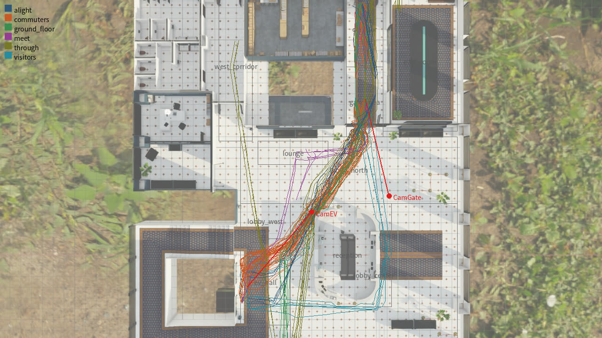 | 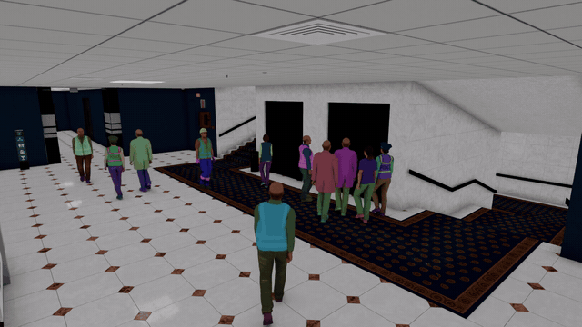 |

Walking speeds, groups, spacing, gate service times and elevator boarding/alighting follow the literature ([docs/validity.en.md](../../validity.en.md)). Comparison with the literature:

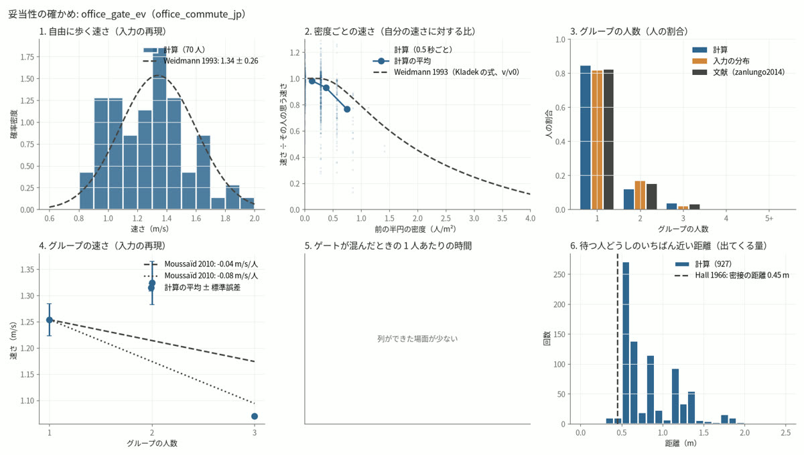

## 2. Operation from the GUI

From a browser on your local PC (through ssh port forwarding), you can go from scene settings → simulation → rendering → MOPF processing → comparison and linking.
The GUI switches between 日本語 and English. Procedures: [docs/operations.en.md](../../operations.en.md).


| Settings | Results | MOPF |
|---|---|---|
| 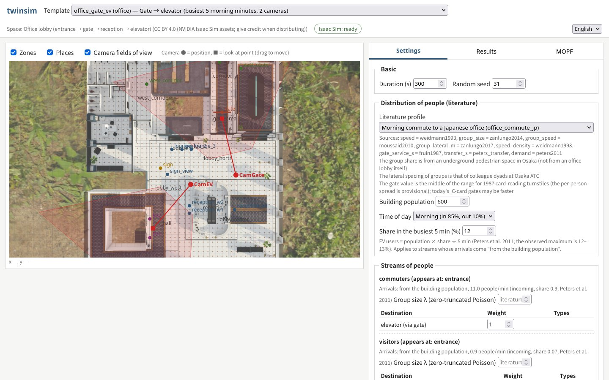 | 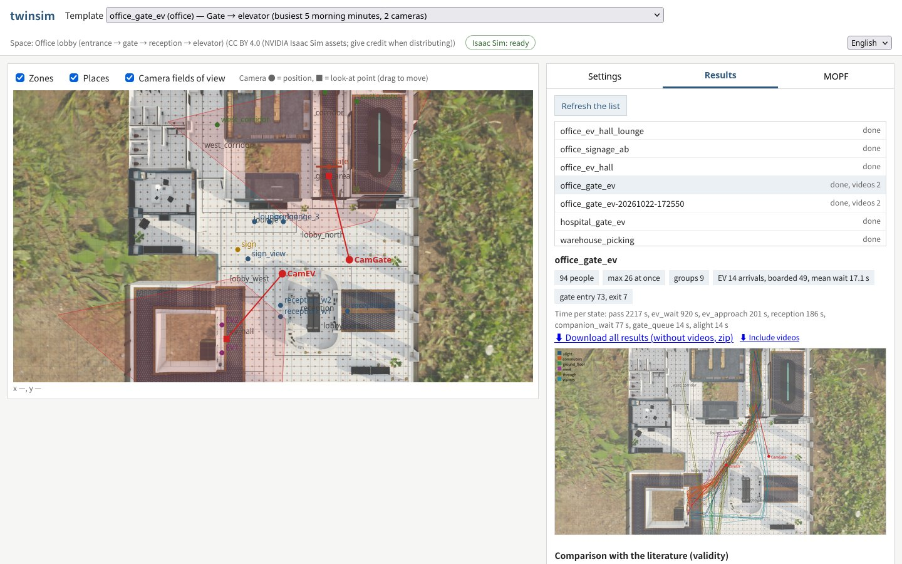 | 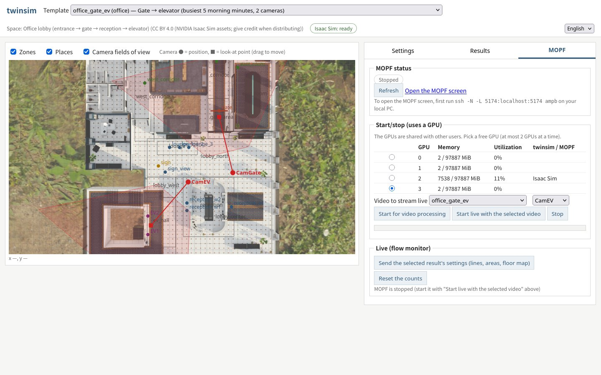 |

In the MOPF tab you pick a free GPU, start and stop MOPF, stream a rendered video live, and watch the flow monitor (line crossings, people per area).

## 3. Detection and tracking with MOPF (compared with the ground truth)

Gate camera. Green = ground truth (visible people), thin colored boxes = MOPF, yellow line = counting line, red = people whose crossing was missed.

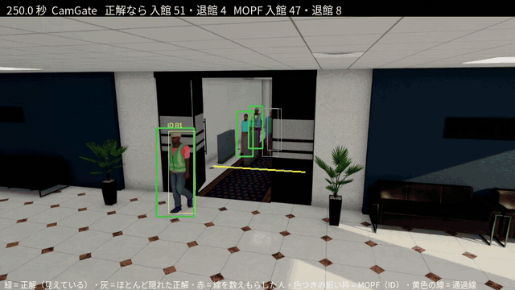

| Camera | MOTA | IDF1 | ID switches (5 min) | Recall | Precision | Error in people on screen | Foot-point error (median, 90%) |
|---|---|---|---|---|---|---|---|
| Gate | 0.868 | 0.859 | 29 | 0.893 | 0.975 | 0.23 | 0.22, 0.40 m |
| Elevator hall | 0.898 | 0.878 | 29 | 0.964 | 0.936 | 0.16 | 0.16, 0.38 m |

- Moving the counting line 1 m inside from the gate raised the share of entries counted from 72% to 91% (people who are already past the line when they appear from behind the door are not counted).
- A missed case (left: ground truth, right: MOPF):

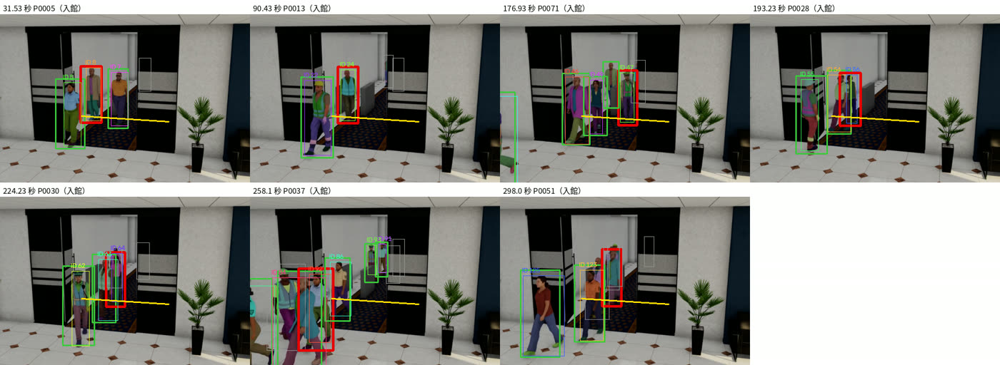

## 4. Linking the same person across the two cameras (inference without ground truth)

A detailed explanation with figures and formulas is in [docs/methods.en.md](../../methods.en.md). MOPF assigns IDs per camera, so the gate ID and the elevator-hall ID are not linked. We infer the same person across the cameras from the expected travel time
(shortest walkable path ÷ walking speed), walking direction and appearance (clothing color, person re-identification models), and assign global IDs (M…).
The ground truth is used only for scoring.

The two cameras side by side, aligned in time (thick box color = predicted global ID; the same ID has the same color in both cameras; ○ = matches the ground-truth person, × = a different person):

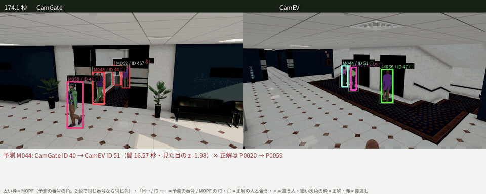

IDF1 over both cameras (78 true transitions between the cameras):

| Method | IDF1 | Correct links / predicted links |
|---|---|---|
| No linking | 0.589 | - |
| Time + direction only | 0.617 | 5 / 23 |
| Learned time + clothing color, hierarchical clustering | **0.845** | 71 / 73 |
| Learned time + OSNet x0.25 (GUI default, same weights as MOPF) | 0.802 | 69 / 79 |
| Learned time + CLIP-ReID ViT-B/16 | 0.806 | 68 / 77 |

Inference takes about 30 s on CPU (crops, features, linking). Predicted links (left = earlier camera, right = later camera):

| Most confident links | Links including errors (red frame = different person) |
|---|---|
| 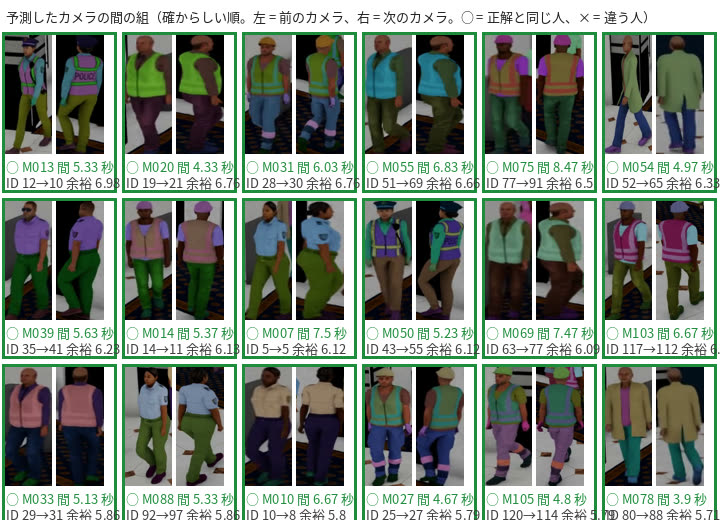 | 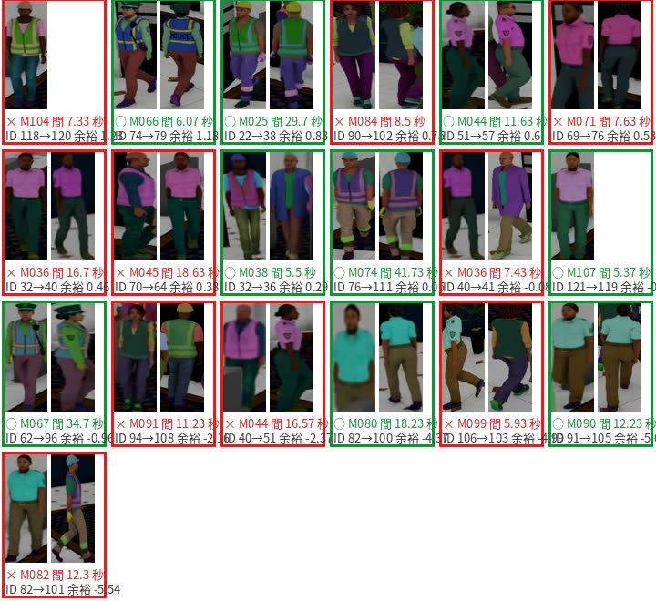 |

The GUI shows the prediction video next to the link table (click a row to jump to that time):

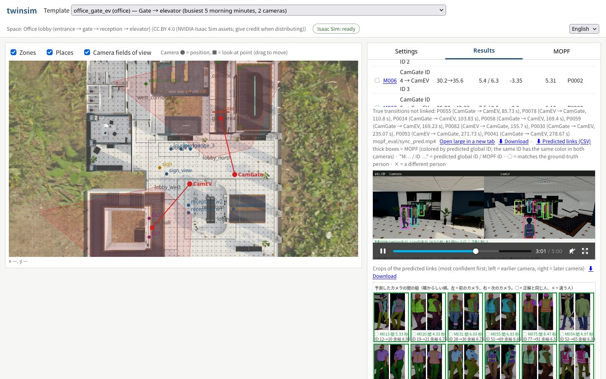

Caveat: the rendering gives each person a different clothing tint, so clothing color is too strong a cue here. On real video the re-identification models should matter more.

## 5. Mapping onto the floor plan

MOPF foot points projected onto the floor (right) and the ground-truth trajectories (left). Elevator-hall camera (median foot-point error 0.16 m):

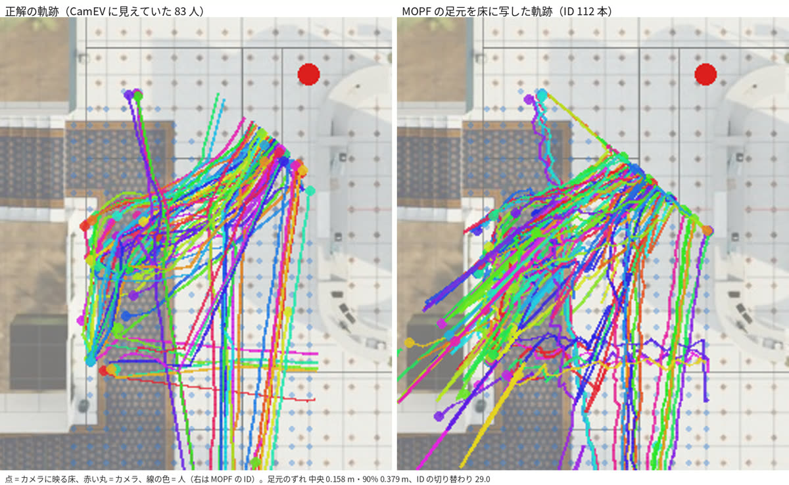

<details><summary>Gate camera</summary>

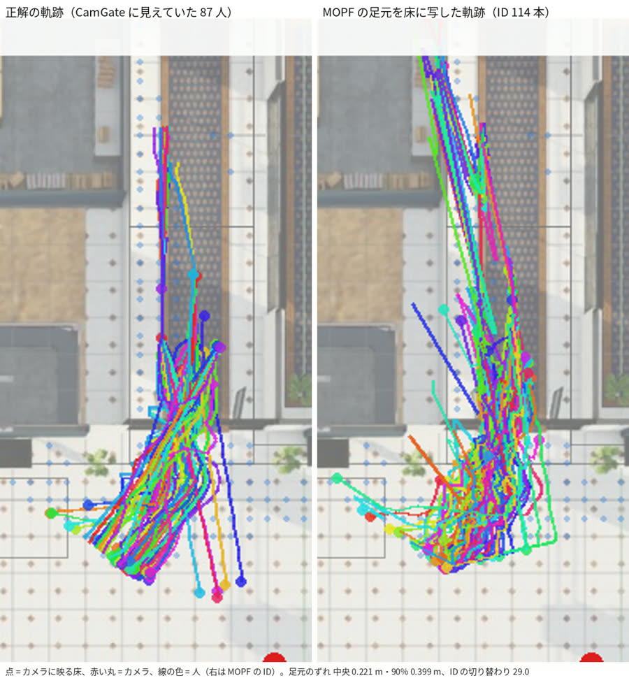

</details>

## 6. Draft evaluation spec and a rehearsal in the virtual space (10/24)

We drafted the end-of-October deliverables of the joint research plan (state labels and ground-truth definitions; evaluation spec and extraction conditions)
and ran the evaluation tools on the twinsim ground truth and the MOPF tracks
(the drafts and tools are joint-research material, so they are kept in the research folder, not in this repository). Results of the baseline method (tracking + online rules):

| Metric (from the research plan) | Gate | Elevator hall |
|---|---|---|
| People-count MAE (per second) | 0.63 (mean 2.3 people) | 0.60 (mean 4.5 people) |
| Direction F1 (same line, same direction, within 2 s) | 0.93 (95% interval 0.91–0.97) | - |
| Elevator-waiting count MAE | - | 1.03 |
| State F1 (waiting for the elevator, passing, …; every 0.5 s) | - | 0.64 |
| Delay until "waiting for the elevator" is recognized | - | median 2.5 s, p95 6.5 s |
| Flow between the two points (share of entrants who appear in the elevator hall within 5 min) | truth 0.90, inferred 0.85 (median 12.4 s, 12.4 s) | |

In a scene with an extra camera covering the meeting area and the sign (computed on CPU, simulated tracker), the state F1 including "waiting for a companion" and "checking the sign" is 0.82,
and join detection has precision 1.0 and recall 0.29.

Findings:
- If "waiting for the elevator" includes walking to the waiting spot, methods that decide only after a person stops always show a delay and a count error (raised as a definition to decide in the joint research).
- The metrics depend on how the observation area is drawn (enlarging the elevator-hall area moved the state F1 from 0.52 to 0.64). It must be fixed beforehand.
- The default cameras did not cover the meeting area or the sign. When choosing real cameras, check that the states to evaluate are visible.

## 7. Progress as a test environment (per evaluation metric of the plan)

○ = can be compared, △ = partly, × = not yet. "10/24" is what changed this time.

| Task (metric) | What works now | What is missing | Rating | 10/24 |
|---|---|---|---|---|
| Current count (count MAE) | Exact ground truth; compared with MOPF (error in people on screen 0.16–0.23) | Approximate boxes; CG appearance | ○ | Computed with the spec's definition (0.60–0.63) |
| Entry/exit direction (direction F1) | 91% of crossings counted | No turning back or tailgating | ○ | Direction F1 0.93 |
| Dwelling (dwell-time error) | Ground-truth stop intervals; dwell times from MOPF can be compared | ID switches cut intervals (1.7× as many predicted intervals) | △ → ○ | Comparison implemented |
| Groups (pair F1) | Ground truth; evaluation (pair F1, errors on elevator-queue neighbors, join detection) | No talking or waiting gestures (animations) | △ | Evaluation implemented; the baseline rule is weak |
| Congestion (level agreement) | Density ground truth; agreement, weighted κ, counterflow, spillover | No rendered video of crowded scenes (above 1.1 people/m²) | △ | Metrics implemented |
| Trends by time of day (aggregate error) | CPU simulation can produce a whole day; 5-min aggregate error | Only 5 min rendered (no 15-min bins) | △ | Unchanged |
| RQ1 states (state F1, confusion matrix) | State ground truth (definition including "unknown"); F1, confusion matrix, acceptance rate, delay | No visual cues (phone, talking, pointing), backlight or reflections, no ground truth for observation text | △–× | Definitions unified, metrics implemented, camera for meeting area and sign added |
| RQ2 allocation of computation | Per-clip ground truth allows evaluation | Difficulty depends on the visual realism in RQ1 | △ | Unchanged |
| 2×2 (NMS/QAQS × VLM) | Relative comparison of overlap handling | Unknown whether crowded queues overlap as in real video | △ | Unchanged |
| Flow between two points, multiple cameras | IDF1 0.59 → 0.80–0.85; entry → elevator-hall flow | Clothing color too strong; only 2 cameras | ○ | Flow metric implemented |
| UC2 elevator dispatch | Elevator-waiting count (0.5 error at car arrivals), waiting time (from tracks) | No floors, car movement or destination dispatch; not looped with dispatch | △ | Metrics implemented |
| UC3 signage | Checking the measurement only | The effect of the display does not emerge | × | Unchanged |
| UC4 ad robot | None | No robot or reactions of people | × | Unchanged |
| Implementation performance (FPS, p95 latency) | Measurable by feeding video to the real MOPF | Not yet taken into the evaluation tools | ○ | Output format defined |

## 8. Next

- Review the draft evaluation spec in the joint research and receive sample real video (decide the data-handling rules before receiving it).
- Convert VLM answers to the evaluation tools' format and compute evidence intervals and acceptance rates.
- Render scenes of 15 min or longer with backlight, and crowded scenes (several GPU hours; confirm before starting).
- Re-compare the re-identification models on renders without per-person clothing tints.

## How this report was made

```bash
tools/report_media.sh docs/report/2026-10-24/media                          # clips, GIFs and images (CPU, about 10 s)
uv run --group gui-test python tools/capture_gui.py docs/report/2026-10-24/media   # GUI captures (while the GUI server is running)
```

Source data: `~/dt-data/twinsim/runs/office_gate_ev/` (outside git). The space uses NVIDIA Isaac Sim assets (CC BY 4.0).
The terms of the character models are not yet confirmed, so these images and videos must not leave the repository.
