# 進捗の報告（2026-10-24）

[English](README.en.md)

twinsim（建物の人流のデジタルツインのシミュレータ）の 10/22〜10/24 の進捗。人の動きを文献の値で計算し、Isaac Sim で監視カメラの映像にして、
人流解析の MOPF（検出・追跡）に通し、正解と比べるところまでを一続きにした。画像・動画はすべて仮想の場面（竹芝の実際の映像ではない）。

使った場面: `office_gate_ev`（オフィスのロビー、朝の混む 5 分、94 人、カメラはゲートと EV 前の 2 台）。MOPF は YOLO11m＋QAQS＋BoostTrack。

GIF は 10〜20 秒の切り出し。同じ切り出しの mp4 も `media/` にある（GitHub ではリンクから再生・ダウンロード）。

## 1. 何を作ったか

```
人の動き（CPU、15 秒）→ 正解（軌跡・状態・枠）→ 描画（Isaac Sim、GPU、1 台 42 分）→ MOPF で検出・追跡 → 正解と比べる・2 台をつなぐ・床の図に写す
```

| 真上から見た場面（人の軌跡・カメラ） | EV 前のカメラ（EV が着いて乗り込む 15 秒） |
|---|---|
| 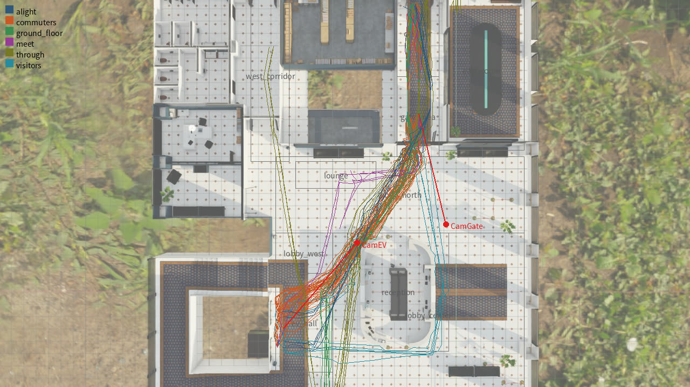 | 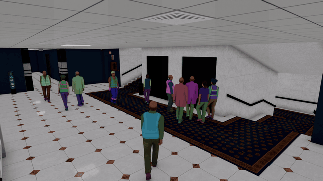 |

人の速さ・グループ・間隔・ゲートの処理時間・EV の乗り降りは文献の値（[docs/validity.md](../../validity.md)）。文献との比べ:

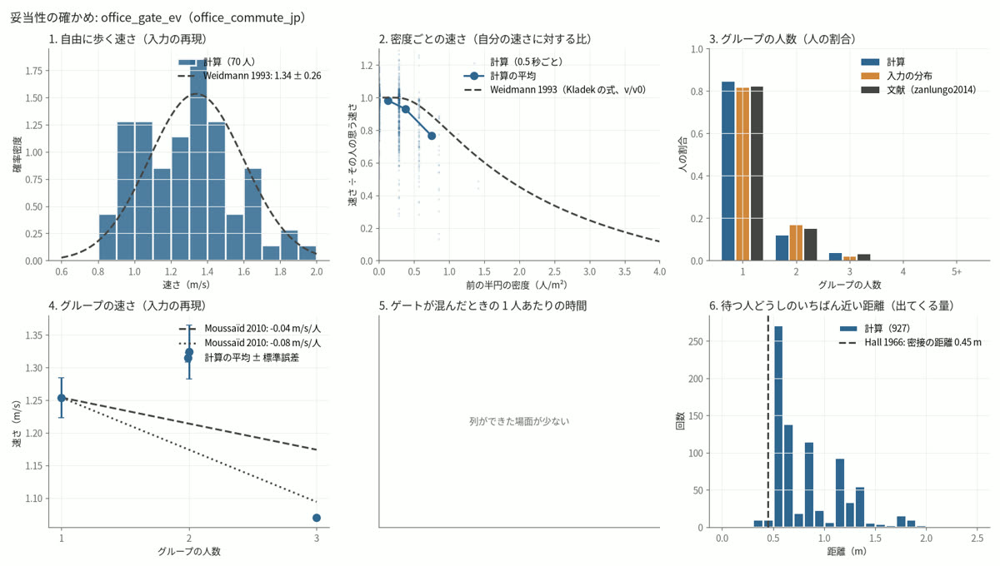

## 2. 画面から操作できる

ブラウザの画面（ssh の転送で手元の PC から）で、場面の設定 → 計算 → 描画 → MOPF での処理 → 比べる・つなぐ、までを操作できる。日本語・English を切り替えられる。
手順は [docs/operations.md](../../operations.md)。


| 設定 | 結果 | MOPF |
|---|---|---|
| 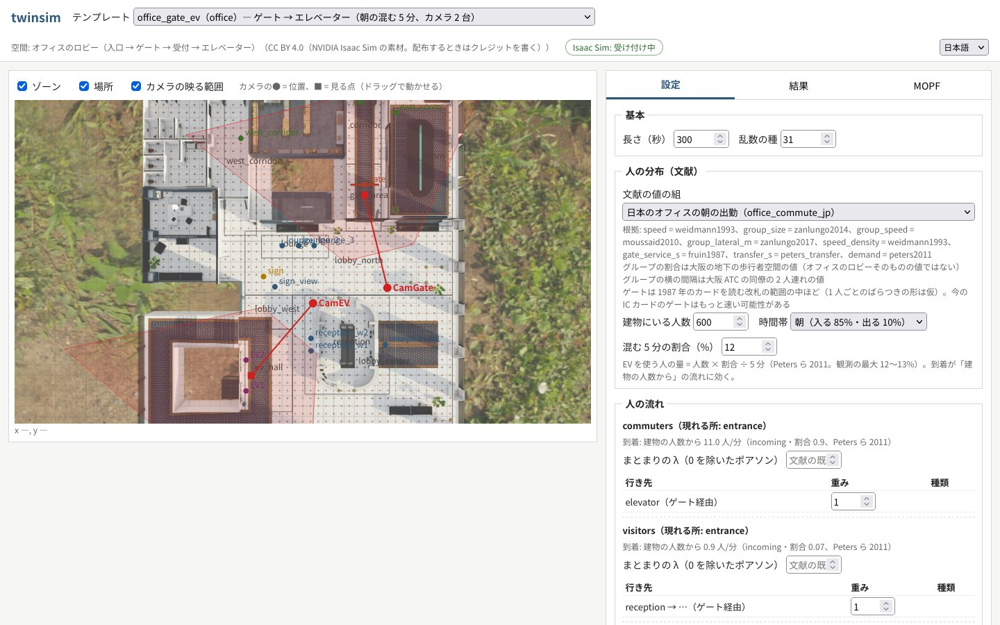 | 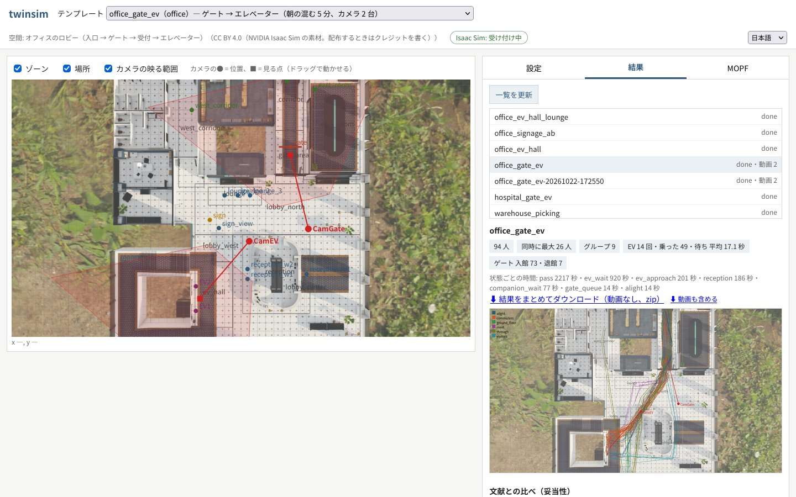 | 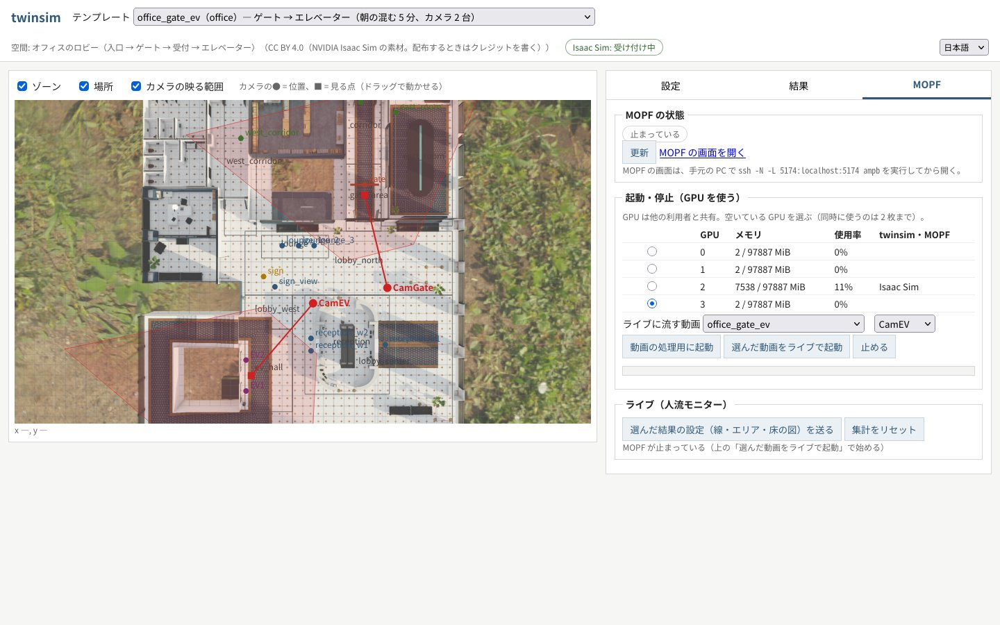 |

MOPF のタブでは、空いている GPU を選んで起動・停止し、描いた動画をライブで流して人流モニター（線の通過・エリアの人数）を見られる。

## 3. MOPF での検出・追跡（正解と比べる）

ゲートのカメラ。緑 = 正解（見えている人）、色つきの細い枠 = MOPF、黄色の線 = 通過線、赤 = 線を数えもらした人。

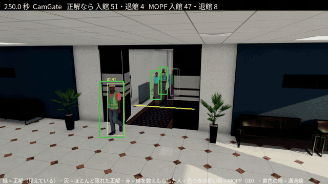

| カメラ | MOTA | IDF1 | ID の切り替わり（5 分） | 再現率 | 適合率 | 画面の人数の誤差 | 足元のずれ（中央・90%） |
|---|---|---|---|---|---|---|---|
| ゲート | 0.868 | 0.859 | 29 | 0.893 | 0.975 | 0.23 人 | 0.22・0.40 m |
| EV 前 | 0.898 | 0.878 | 29 | 0.964 | 0.936 | 0.16 人 | 0.16・0.38 m |

- 通過線をゲートから 1 m 内側に引くと、入館を数えられる割合が 72% → 91% になった（扉の陰から現れた時点で線を越えていると数えられない）。
- 数えもらしの場面（左: 正解、右: MOPF）:

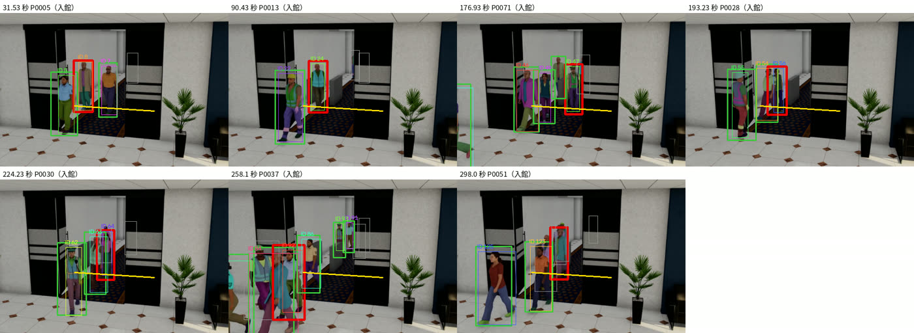

## 4. 2 台の間で同じ人をつなぐ（正解を使わない推論）

MOPF はカメラごとに ID を付けるので、ゲートの ID と EV 前の ID はつながらない。来るはずの時間（歩ける所の上の最短の道のり ÷ 歩く速さ）・
歩く向き・見た目（服の色、人物照合のモデル）から、2 台の間の同じ人を推論し、全体の番号（M…）を付ける。正解は採点にだけ使う。

2 台を時刻でそろえて並べた動画（太い枠の色 = 予測した全体の番号。2 台で同じ番号なら同じ色。○ = 正解の人と合う、× = 違う人）:

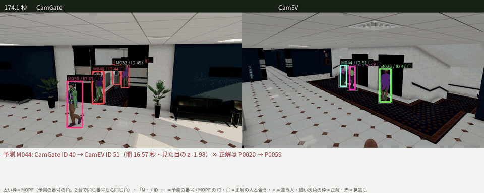

2 台を合わせた IDF1（本当のカメラの間の移動は 78 回）:

| 方法 | IDF1 | 正しくつないだ組 / 予測した組 |
|---|---|---|
| つながない | 0.589 | - |
| 時間＋向きだけ | 0.617 | 5 / 23 |
| 時間（学んだ）＋服の色、階層クラスタリング | **0.845** | 71 / 73 |
| 時間（学んだ）＋OSNet x0.25（画面の既定、MOPF と同じ重み） | 0.802 | 69 / 79 |
| 時間（学んだ）＋CLIP-ReID ViT-B/16 | 0.806 | 68 / 77 |

推論にかかる時間は CPU で 30 秒ほど（切り出し・特徴・つなぐ計算）。予測した組（左 = 前のカメラ、右 = 次のカメラ）:

| 確からしい組（上位） | 誤りを含む組（下位、赤枠 = 違う人） |
|---|---|
| 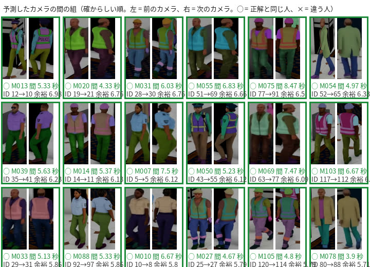 | 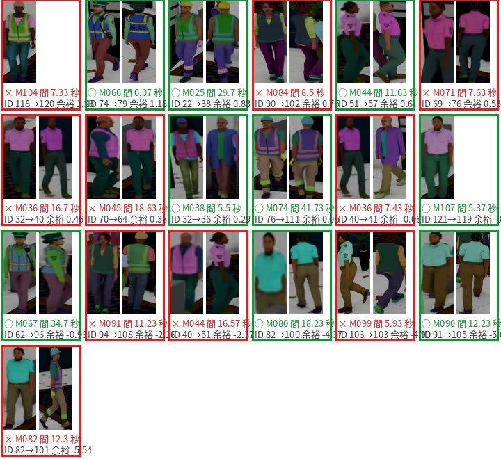 |

画面では、予測の動画と、組の表（押すと動画がその時刻へ飛ぶ）を並べて見られる:

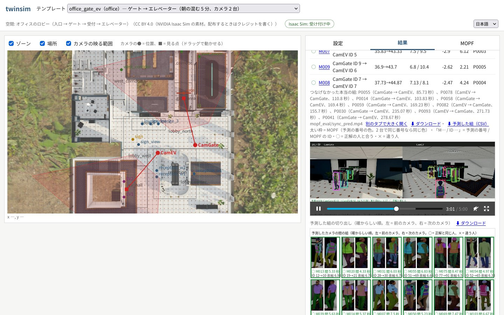

注意: この場面は描画で人ごとに服の色を変えているので、服の色が効きすぎる。実際の映像では人物照合のモデルの差が出る見込み。

## 5. 床の図に写す

MOPF の枠の足元を床に写した軌跡（右）と、正解の軌跡（左）。EV 前のカメラ（足元のずれ 中央 0.16 m）:

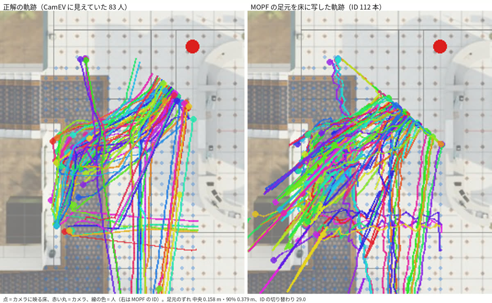

<details><summary>ゲートのカメラ</summary>

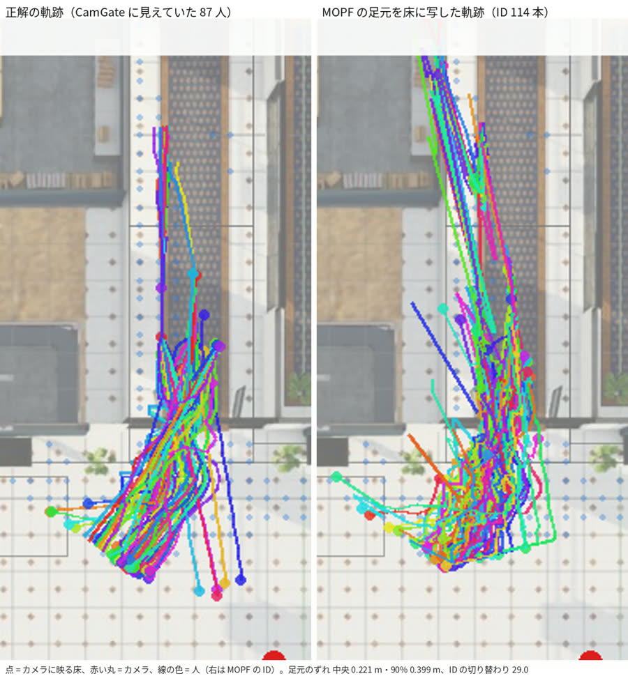

</details>

## 6. 評価仕様の案と、仮想空間でのリハーサル（10/24）

共同研究の計画書の 10 月末の成果物（状態ラベルと正解の定義、評価仕様と抽出条件）の案を作り、評価の道具で twinsim の正解と MOPF の追跡に通した
（案と道具は共同研究の資料なので、このリポジトリではなく研究のフォルダに置いている）。基準の方式（追跡＋オンラインのルール）の結果:

| 指標（計画書の評価指標） | ゲート | EV 前 |
|---|---|---|
| 人数 MAE（1 秒ごと） | 0.63 人（平均 2.3 人） | 0.60 人（平均 4.5 人） |
| 方向 F1（同じ線・同じ向き・2 秒以内） | 0.93（95% 区間 0.91〜0.97） | - |
| EV 待ち人数 MAE | - | 1.03 人 |
| 状態 F1（EV 待ち・通過など、0.5 秒ごと） | - | 0.64 |
| EV 待ちと判定するまでの遅れ | - | 中央 2.5 秒・p95 6.5 秒 |
| 2 地点の流れ（入館から 5 分以内に EV 前に現れた割合） | 正解 0.90・推論 0.85（秒の中央値 12.4・12.4） | |

待ち合わせの場所と案内板を映すカメラを足した場面（CPU で計算、模擬の追跡）では、同行者待ち・案内確認を含む状態 F1 0.82、合流の検出の適合率 1.0・再現率 0.29。

分かったこと:
- 「EV 待ち」に止まる場所へ向かう歩きを含める定義だと、止まってから判定する方式には遅れと人数の誤差が必ず出る（定義を決める点として共同研究に出す）。
- 観測エリアの引き方で指標が変わる（EV 前のエリアを広げると状態 F1 0.52 → 0.64）。先に決めて固定する必要がある。
- 既定のカメラは待ち合わせの場所・案内板を映していなかった。実際のカメラ選びでも、評価したい状態が映るかを確かめる。

## 7. 検証の環境としての進捗（計画書の評価指標ごと）

○ = 比べられる、△ = 一部、× = まだ。「10/24」は今回の変化。

| タスク（評価指標） | 今できること | 足りない点 | 判定 | 10/24 |
|---|---|---|---|---|
| 現在人数（人数 MAE） | 正確な正解。MOPF との比べ済み（画面の人数の誤差 0.16〜0.23 人） | 枠が近似。CG の見た目 | ○ | 仕様の定義で出せる（0.60〜0.63 人） |
| 入退館の方向（方向 F1） | 通過線で数えた割合 91% | 引き返し・共連れの動きがない | ○ | 方向 F1 0.93 |
| 滞留（滞在時間の誤差） | 止まった区間の正解あり。MOPF の結果から滞在時間を出して比べられる | ID の切り替わりで区間が切れる（方式の区間が 1.7 倍） | △ → ○ | 比べる部分を作った |
| グループ（ペア F1） | 正解あり。推定の評価（ペア F1・EV の列の隣を誤る数・合流の検出） | 話す・相手を待つ動作（アニメーション）がない | △ | 評価を作った。基準のルールは弱い |
| 混雑度（レベルの一致率） | 密度の正解、一致率・重みつき κ・対向流・はみ出し | 混雑の場面（最大 1.1 人/m² を超える）を描いた映像がない | △ | 指標を作った |
| 時間帯別の傾向（集計の誤差） | 計算（CPU）なら 1 日分も作れる。5 分ごとの集計誤差 | 描画は 5 分だけ（15 分ごとは出せない） | △ | 変わらず |
| RQ1 状態（状態 F1・混同行列） | 状態の正解（「不明」を含む定義）。F1・混同行列・受理率・確定までの遅れ | 見た目の手がかり（スマホ・話す・指す）、逆光・反射、観察の文の正解がない | △〜× | 定義をそろえ、指標を作った。待ち合わせ・案内板のカメラを足した |
| RQ2 計算の配分 | 区間ごとの正解があるので評価できる | 難しさの分布が RQ1 の見た目に左右される | △ | 変わらず |
| 2×2（NMS／QAQS × VLM） | 重なりの補正の相対的な比べ | 密集した列の重なり方が実際と同じか不明 | △ | 変わらず |
| 2 地点の流れ・複数カメラ | IDF1 0.59 → 0.80〜0.85。入館 → EV 前の流れ | 服の色が効きすぎる。カメラ 2 台だけ | ○ | 流れの指標を作った |
| UC2 EV 配車 | EV 待ち人数（EV が着いた時刻の誤差 0.5 人）、待ち時間（追跡から） | 階・かごの移動・行先階予約がなく、配車と一周させていない | △ | 指標を作った |
| UC3 サイネージ | 測り方の確かめ | 表示の効果が結果として出てこない | × | 変わらず |
| UC4 アドロボット | なし | ロボットと人の反応がない | × | 変わらず |
| 実装性能（FPS・p95 遅延） | 実際の MOPF に映像を入れて測れる | 評価の道具への取り込み | ○ | 出力の形を決めた |

## 8. 次のこと

- 評価仕様の案を共同研究で確かめ、実際の映像のサンプルを受け取る（受け取る前に扱いの決まりを決める）。
- VLM の答えを評価の道具の形に変換し、根拠の区間・受理率を出す。
- 15 分以上・逆光のある場面、混雑の場面を描画する（GPU で数時間。始める前に確認する）。
- 服の色を人ごとに変えない描画で、人物照合のモデルを比べ直す。

## この報告の作り方

```bash
tools/report_media.sh docs/report/2026-10-24/media                          # 切り出しの動画・GIF・画像（CPU、10 秒ほど）
uv run --group gui-test python tools/capture_gui.py docs/report/2026-10-24/media   # 画面のキャプチャ（GUI のサーバーが動いているとき）
```

元のデータは `~/dt-data/twinsim/runs/office_gate_ev/`（git の外）。空間は NVIDIA Isaac Sim の素材（CC BY 4.0）。
人物モデルの利用条件は確かめていないので、この画像・動画はリポジトリの外に出さない。
