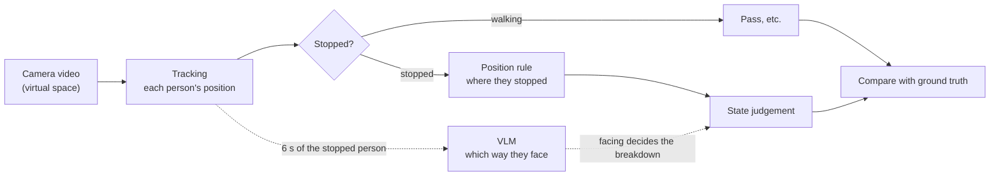
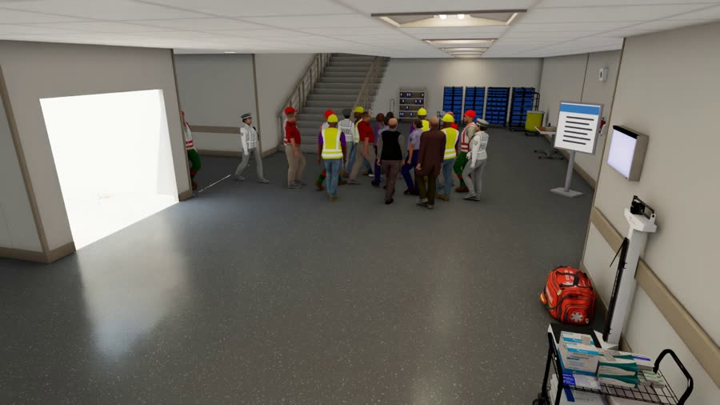
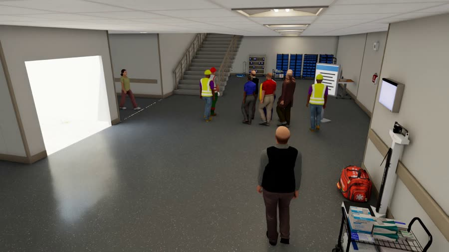

# What was compared

[Contents](README.en.md#toc) ｜ [← Where we are](01_status.en.md) ｜ [Results: state judgement →](03_results.en.md) ｜ [Glossary](glossary.en.md) ｜ [日本語](02_method.md)

**On this page**: [The procedure](#pipeline) · [The two scenes](#scenes) · [The three methods](#methods) · [How it was evaluated](#evaluation)

## The procedure

The dotted path adds the VLM. Everything up to [tracking](glossary.en.md#tracking) is shared; what differs is how stopped people are broken down.

## The two scenes

Both use a virtual hospital hall standing in for an elevator (EV) lobby. Neither is the Takeshiba layout.

| Item | [Hall A](glossary.en.md#hall-a-term) (position tells) | [Hall B](glossary.en.md#hall-b-term) (position does not tell) |
|---|---|---|
| Video |  |  |
| People, length | 94 people, 6 min | 92 people, 6 min |
| Where companions wait | Outside the EV wait area | Inside the EV wait area |
| Guide sign | A little away from the end of the queue | Right next to the queue |
| Clips shown to the VLM | 692 | 481 |
| Evaluated [person × 0.5 s](glossary.en.md#person-step) steps | 4,284 | 3,313 |

Tracking is [MOPF](glossary.en.md#mopf) (YOLO11m + [QAQS](glossary.en.md#qaqs) + [BoostTrack](glossary.en.md#boosttrack)); the VLM is [Qwen3-VL-8B](glossary.en.md#qwen).

## The three methods

| Method | What it looks at | How a stopped person is judged |
|---|---|---|
| [Position rule](glossary.en.md#position-rule) | Foot position from tracking and how long they stopped | EV wait area → [EV wait](glossary.en.md#ev-wait), in front of the sign → [sign check](glossary.en.md#sign-check), elsewhere → [companion wait](glossary.en.md#companion-wait) |
| [Ask the VLM for the state](glossary.en.md#vlm-state) | 6 s of video and the trajectory | The VLM answers the state directly |
| [Rule + VLM facing](glossary.en.md#rule-plus-facing) | Only for people the position rule sees as stopped, ask the VLM which way they face | Door → EV wait, sign → sign check, anything else → companion wait |

> [!NOTE]
> The VLM does not recognise that someone is waiting for a companion. Its observation, "facing neither the door nor the sign", is turned into companion wait by a fixed [mapping](glossary.en.md#facing-map).
> The mapping was chosen after seeing Hall A and applied unchanged to Hall B.

## How it was evaluated

- At each [person × 0.5 s](glossary.en.md#person-step) step, the latest judgement made from video up to that moment is compared with the ground truth.
- A VLM answer expires after 8 s ([time to live](glossary.en.md#ttl)), and the rule's judgement takes over.
- [F1](glossary.en.md#f1) is the mean over five states ([EV wait](glossary.en.md#ev-wait), [companion wait](glossary.en.md#companion-wait), [sign check](glossary.en.md#sign-check), [pass](glossary.en.md#pass), [other](glossary.en.md#other)), and [unknown](glossary.en.md#unknown) counts as an error.
- Ranges in brackets are [95% intervals](glossary.en.md#ci).

---

[Contents](README.en.md#toc) ｜ [← Where we are](01_status.en.md) ｜ [Results: state judgement →](03_results.en.md) ｜ [Glossary](glossary.en.md) ｜ [Back to top](#top)
