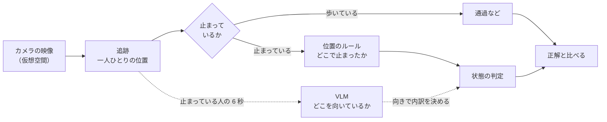
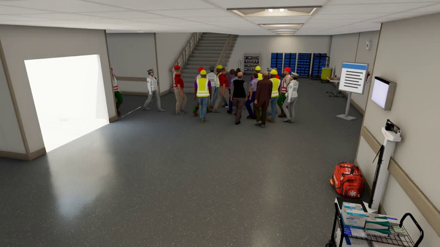
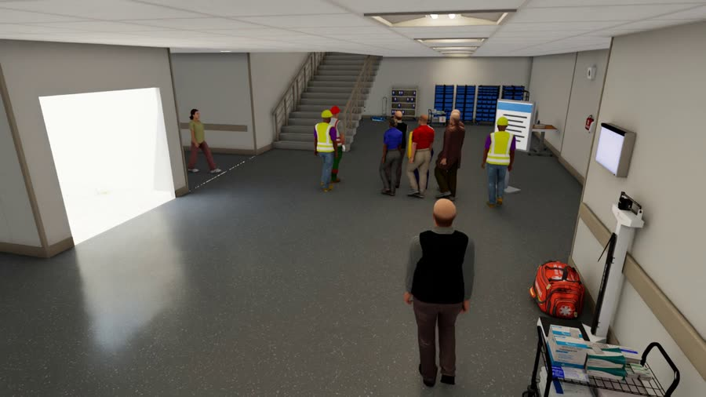

# 何を比べたか

[目次](README.md#toc) ｜ [← 今の位置](01_status.md) ｜ [結果: 状態の判定 →](03_results.md) ｜ [用語集](glossary.md) ｜ [English](02_method.en.md)

**このページ**: [手順の全体](#pipeline)・[2 つの場面](#scenes)・[3 つの方式](#methods)・[評価のしかた](#evaluation)

## 手順の全体

点線の部分が VLM を足す経路。[追跡](glossary.md#tracking)までは共通で、止まっている人の内訳の決め方を比べた。

## 2 つの場面

どちらも仮想の病院の広間をエレベーター（EV）前に見立てたもの。竹芝の配置ではない。

| 項目 | [広間 A](glossary.md#hall-a-term)（位置で分かる） | [広間 B](glossary.md#hall-b-term)（位置で分からない） |
|---|---|---|
| 映像 |  |  |
| 人数・長さ | 94 人・6 分 | 92 人・6 分 |
| 同行者の待つ場所 | EV 待ちエリアの外 | EV 待ちエリアの中 |
| 案内板 | 待ち列の端から少し離れている | 待ち列のすぐ隣 |
| VLM に見せたクリップ | 692 本 | 481 本 |
| 評価の数（[人 × 0.5 秒](glossary.md#person-step)） | 4,284 段 | 3,313 段 |

追跡は [MOPF](glossary.md#mopf)（YOLO11m＋[QAQS](glossary.md#qaqs)＋[BoostTrack](glossary.md#boosttrack)）、VLM は [Qwen3-VL-8B](glossary.md#qwen)。

## 3 つの方式

| 方式 | 見ているもの | 止まっている人の判定 |
|---|---|---|
| [位置のルール](glossary.md#position-rule) | 追跡の足元の位置と、止まった時間 | EV 待ちエリア → [EV 待ち](glossary.md#ev-wait)、案内板の前 → [案内確認](glossary.md#sign-check)、それ以外 → [同行者待ち](glossary.md#companion-wait) |
| [VLM に状態を聞く](glossary.md#vlm-state) | 6 秒の映像と軌跡 | VLM が状態を直接答える |
| [ルール＋VLM の向き](glossary.md#rule-plus-facing) | 位置のルールで止まっている人だけ、VLM に向きを聞く | 扉 → EV 待ち、案内板 → 案内確認、それ以外 → 同行者待ち |

> [!NOTE]
> VLM は「同行者を待っている」と見抜いているわけではない。「扉も案内板も向いていない」という観察を、決めた[対応](glossary.md#facing-map)で同行者待ちにしている。
> この対応は広間 A の結果を見て決め、広間 B には変えずに当てた。

## 評価のしかた

- [人 × 0.5 秒](glossary.md#person-step)ごとに、その時点までの映像で出した最新の判定を正解と比べる。
- VLM の答えは 8 秒で切れ（[有効期限](glossary.md#ttl)）、切れたらルールの判定に戻る。
- [F1](glossary.md#f1) は [EV 待ち](glossary.md#ev-wait)・[同行者待ち](glossary.md#companion-wait)・[案内確認](glossary.md#sign-check)・[通過](glossary.md#pass)・[その他](glossary.md#other)の 5 つの平均で、[不明](glossary.md#unknown)は誤りに数える。
- 括弧の幅は [95% 区間](glossary.md#ci)。

---

[目次](README.md#toc) ｜ [← 今の位置](01_status.md) ｜ [結果: 状態の判定 →](03_results.md) ｜ [用語集](glossary.md) ｜ [ページの先頭へ](#top)
