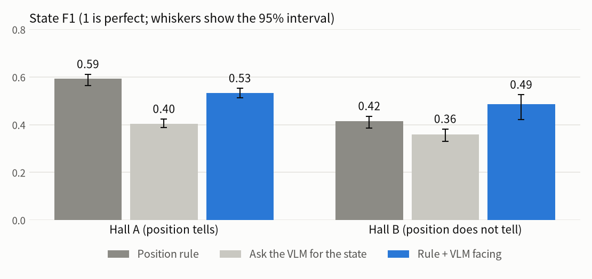
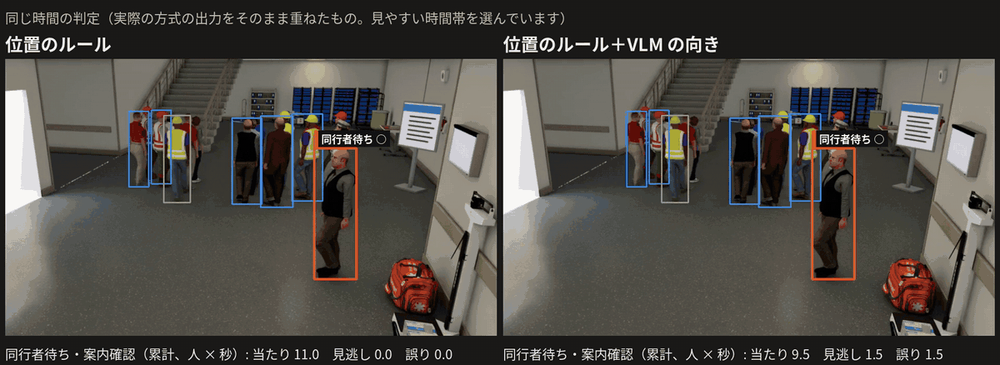
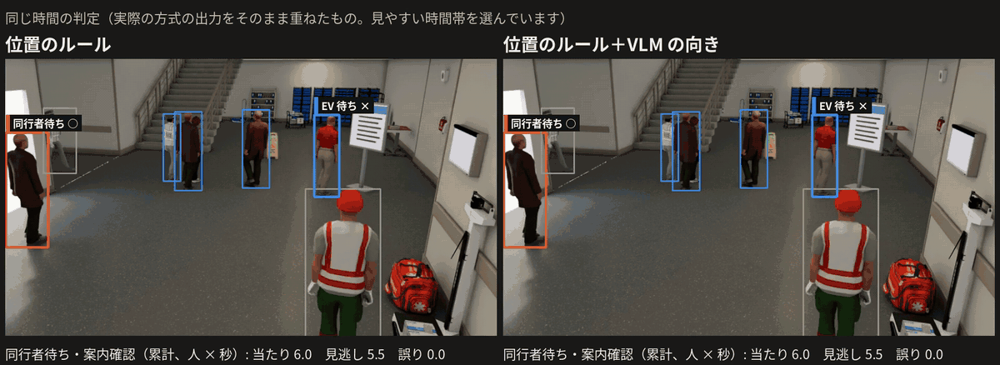
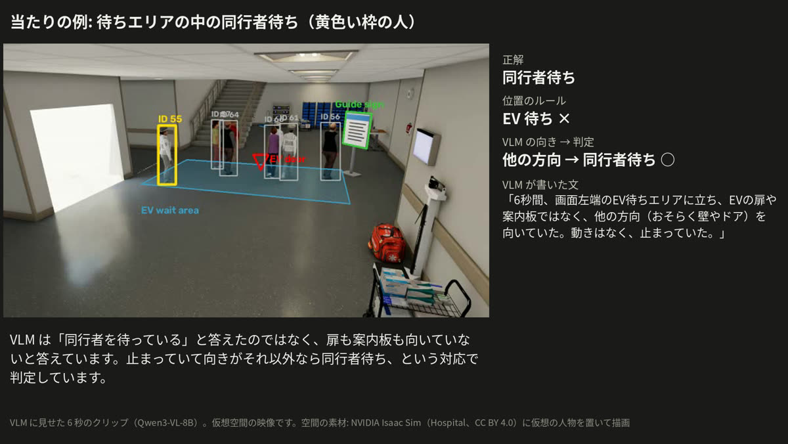
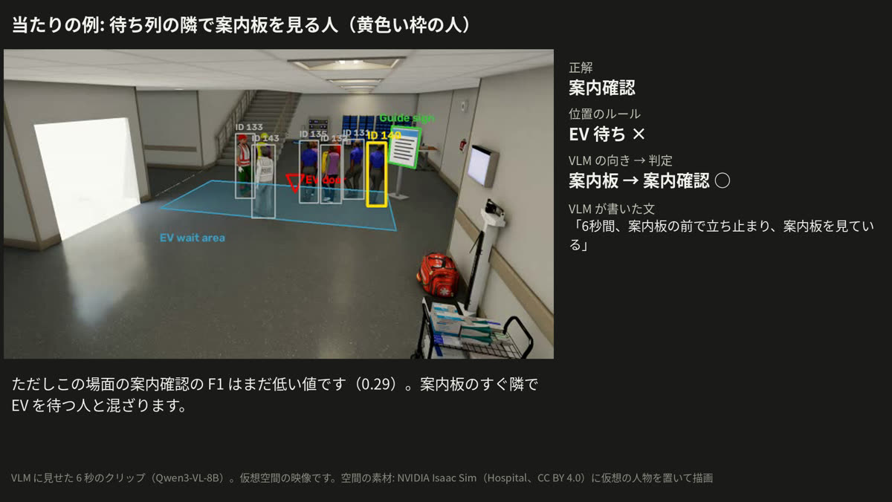
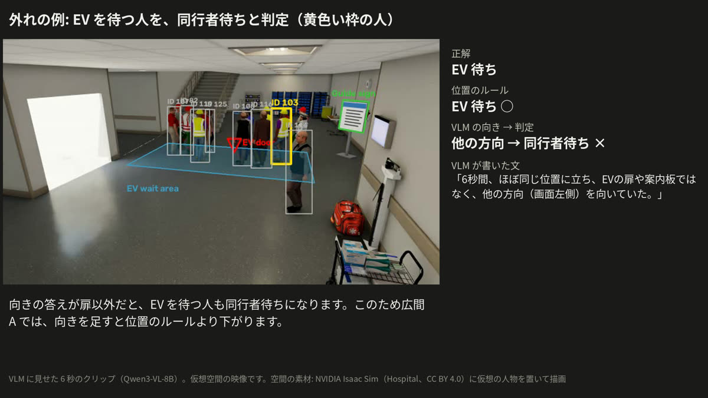
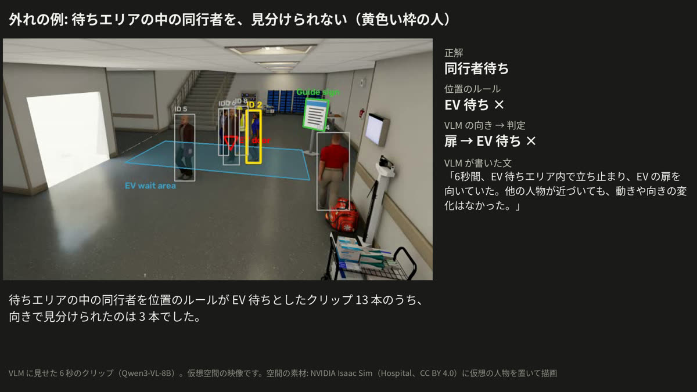

# Results: state judgement

[Contents](README.en.md#toc) ｜ [← What was compared](02_method.en.md) ｜ [Timing and compute →](04_timing_cost.en.md) ｜ [Glossary](glossary.en.md) ｜ [日本語](03_results.md)

**On this page**: [Results table](#table) · [Hall A video](#hall-a) · [Hall B video](#hall-b) · [Successes](#hits) · [Failures](#misses) · [The rule used as the baseline](#fair-rule)

## Results table

The VLM's facing answer wins only in the scene where position does not tell.

<picture>
  <source media="(prefers-color-scheme: dark)" srcset="media/f1_en_dark.png">
  
</picture>

| Scene | [Position rule](glossary.en.md#position-rule) | [Ask the VLM for the state](glossary.en.md#vlm-state) | [Rule + VLM facing](glossary.en.md#rule-plus-facing) |
|---|---|---|---|
| [Hall A](glossary.en.md#hall-a-term) (position tells) | **0.59** (0.57–0.61) | 0.40 (0.39–0.42) | 0.53 (0.51–0.55) |
| [Hall B](glossary.en.md#hall-b-term) (position does not tell) | 0.42 (0.39–0.44) | 0.36 (0.33–0.38) | **0.49** (0.42–0.53) |

- Hall A: adding facing mistakes people waiting for the EV for companion waiters. Companion wait F1 falls from 0.83 to 0.62.
- Hall B: facing wins, but the [95% intervals](glossary.en.md#ci) overlap slightly. Most of the gap is sign check (F1 0.00 → 0.29); companion wait is about the same (0.59 → 0.62).
- Asked for the state directly, the VLM never answers companion wait (F1 0.00).
- Outlook: use the rule where position tells and the VLM where it does not. That combination has not been measured yet ([next steps](07_next.en.md#roadmap)).

Every method is in [all numbers](08_appendix.en.md#all-numbers).

> [!NOTE]
> Labels inside the videos are in Japanese: 位置のルール = position rule, ルール＋VLM の向き = rule + VLM facing, EV 待ち = EV wait, 同行者待ち = companion wait, 案内確認 = sign check, その他 = other, 通過 = pass.

## Hall A video

The same period under the position rule (left) and rule + VLM facing (right). Boxes and labels are the methods' actual output.

Box colours: blue = EV wait, orange = companion wait, green = sign check, yellow = other, grey = pass. ○ = matches the ground truth, × = does not.

The right side collects more × marks: when the facing answer is not the door, people waiting for the EV also become companion waiters. [Whole 20 s (mp4)](media/compare_hall.mp4). The period was chosen for readability.

## Hall B video

The position rule calls everyone inside the wait area EV wait. Facing separates some people, but × marks also appear in front of the sign. [Whole 20 s (mp4)](media/compare_hall2.mp4).

## Successes

The 6 s clip exactly as shown to the VLM, with the text it wrote. The yellow box is the person asked about.

| A companion waiter inside the wait area | Someone reading the sign next to the queue |
|---|---|
|  |  |
| Position rule: EV wait ×. Facing: companion wait ○ ([mp4](media/example_hit_hall2.mp4)) | Position rule: EV wait ×. Facing: sign check ○ ([mp4](media/example_hit_sign.mp4)) |

Sign check F1 in Hall B is still low at 0.29.

## Failures

| Someone waiting for the EV judged as companion wait (Hall A) | A companion waiter inside the wait area not separated (Hall B) |
|---|---|
|  |  |
| The VLM answered "another direction" ([mp4](media/example_miss.mp4)) | The VLM answered "door" ([mp4](media/example_miss_hall2.mp4)) |

Of the 13 clips of the right-hand kind (companion waiters the position rule called EV wait), facing separated 3.

## The rule used as the baseline

The conclusion depends on the baseline, so it is stated here.

| Rule | How a stopped person is treated | Hall A | Hall B |
|---|---|---|---|
| [Spec rule](glossary.en.md#spec-rule) | "Other" unless there is a defined meeting place | 0.43 | 0.30 |
| [Position rule](glossary.en.md#position-rule) (used in this report) | Stopped outside the area and the sign means companion wait | **0.59** | 0.42 |
| (for reference) Rule + VLM facing | | 0.53 | **0.49** |

These scenes have no defined meeting place, so the spec rule cannot answer companion wait. Against it, VLM facing looks better in both scenes (0.43 → 0.53), but that is not a fair comparison.
The position rule used in this report follows the same idea as the October preliminary rule.

Conversely, the virtual scenes have almost nobody stopping for other reasons, such as a phone call or a chat, so the position rule may look better here than it would in reality ([what we cannot say](06_limits.en.md#cannot)).

---

[Contents](README.en.md#toc) ｜ [← What was compared](02_method.en.md) ｜ [Timing and compute →](04_timing_cost.en.md) ｜ [Glossary](glossary.en.md) ｜ [Back to top](#top)
