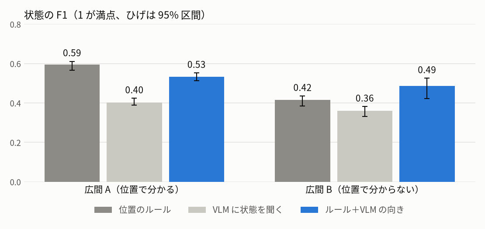
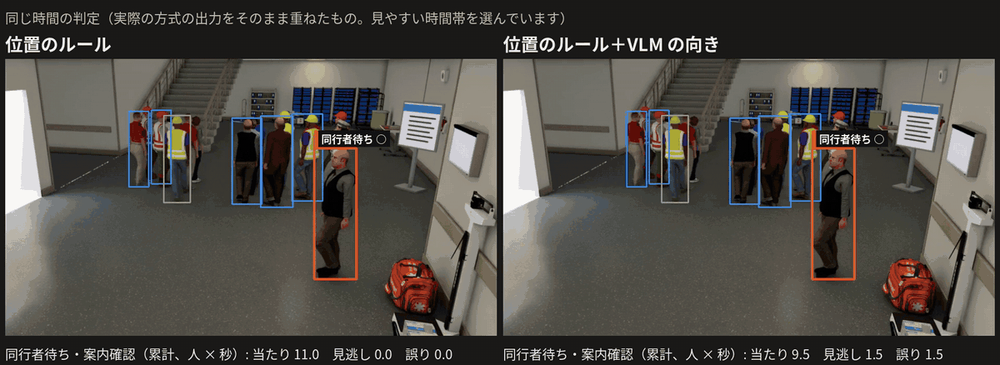
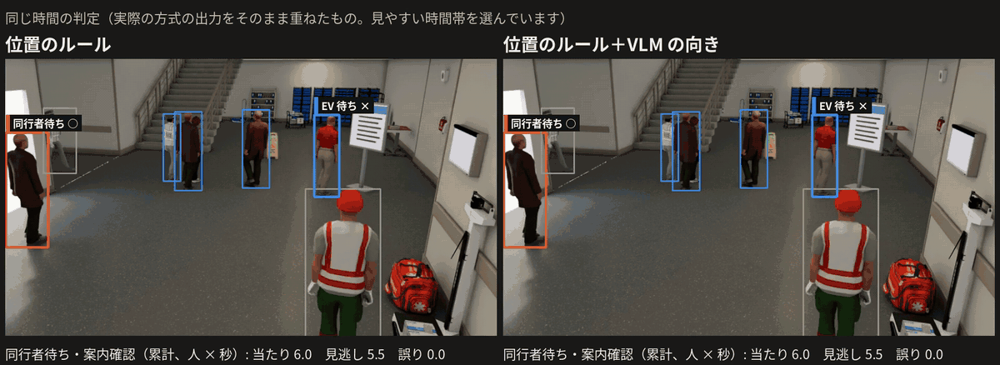
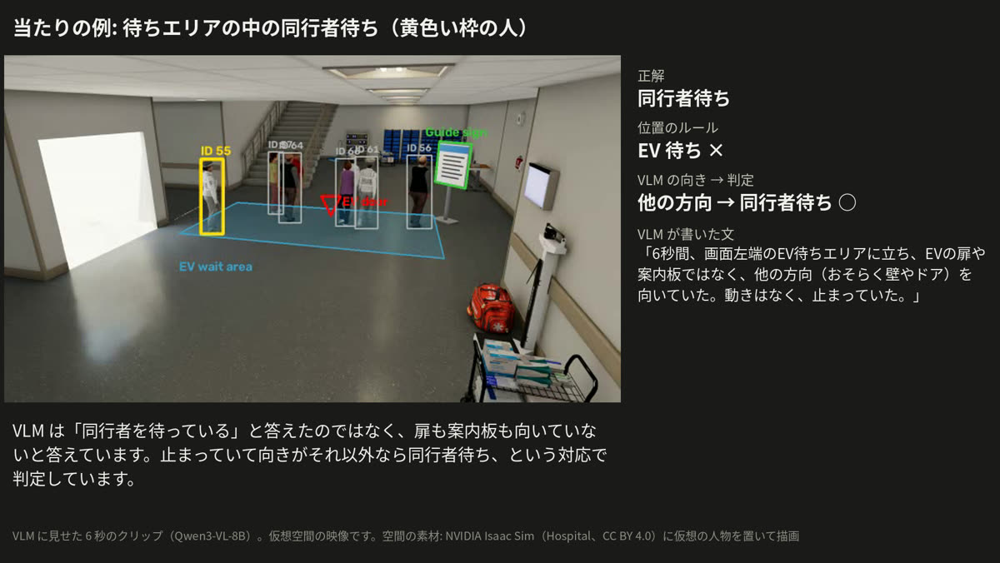
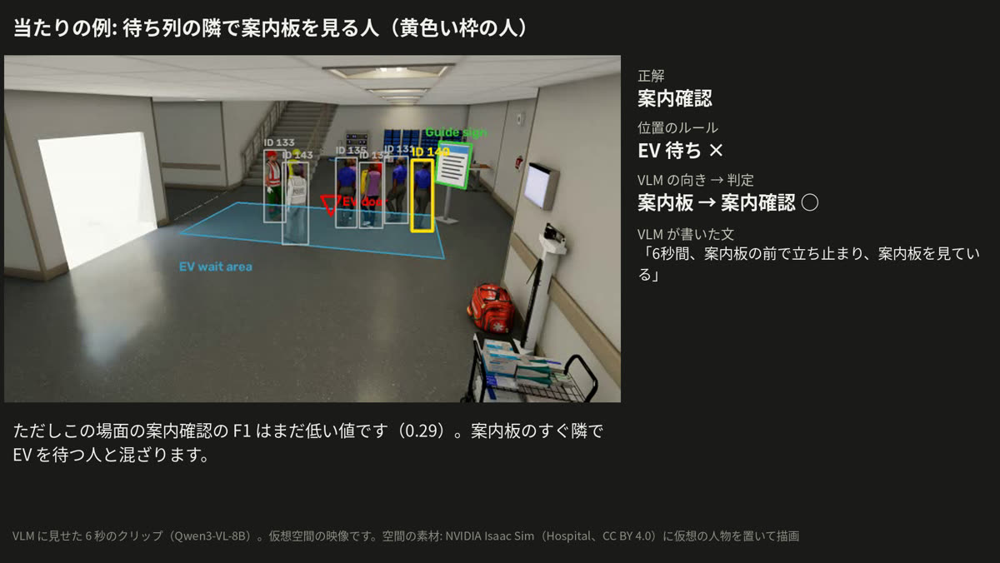
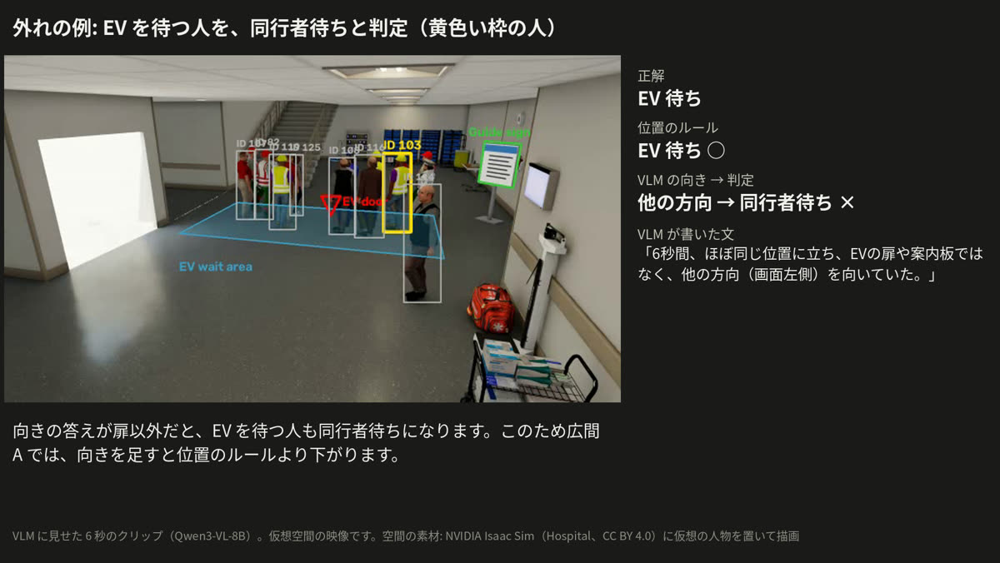
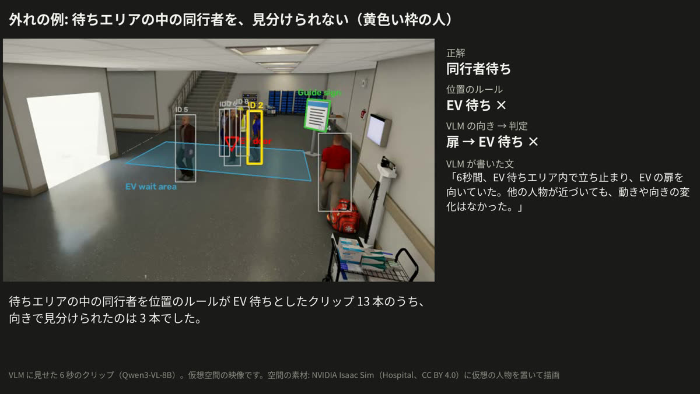

# 結果: 状態の判定

[目次](README.md#toc) ｜ [← 何を比べたか](02_method.md) ｜ [時刻と計算量 →](04_timing_cost.md) ｜ [用語集](glossary.md) ｜ [English](03_results.en.md)

**このページ**: [結果の表](#table)・[広間 A の映像](#hall-a)・[広間 B の映像](#hall-b)・[当たりの例](#hits)・[外れの例](#misses)・[比べる相手のルール](#fair-rule)

## 結果の表

VLM の向きが上回るのは、位置で分からない場面だけだった。

<picture>
  <source media="(prefers-color-scheme: dark)" srcset="media/f1_ja_dark.png">
  
</picture>

| 場面 | [位置のルール](glossary.md#position-rule) | [VLM に状態を聞く](glossary.md#vlm-state) | [ルール＋VLM の向き](glossary.md#rule-plus-facing) |
|---|---|---|---|
| [広間 A](glossary.md#hall-a-term)（位置で分かる） | **0.59**（0.57〜0.61） | 0.40（0.39〜0.42） | 0.53（0.51〜0.55） |
| [広間 B](glossary.md#hall-b-term)（位置で分からない） | 0.42（0.39〜0.44） | 0.36（0.33〜0.38） | **0.49**（0.42〜0.53） |

- 広間 A: 向きを足すと、EV を待つ人を同行者待ちと誤る。同行者待ちの F1 は 0.83 から 0.62 に下がる。
- 広間 B: 向きが上回るが、[95% 区間](glossary.md#ci)はわずかに重なる。差の多くは案内確認（F1 0.00 → 0.29）で、同行者待ちはほぼ同じ（0.59 → 0.62）。
- 状態を直接聞くと、同行者待ちは 1 度も出ない（F1 0.00）。
- 見通し: 位置で分かる所はルール、分からない所に VLM。この組み合わせはまだ測っていない（[これから進めること](07_next.md#roadmap)）。

全方式の値は [全部の数値](08_appendix.md#all-numbers)。

## 広間 A の映像

同じ時間を、位置のルール（左）とルール＋VLM の向き（右）で並べた。枠と文字は実際の方式の出力。

枠の色: 青 = EV 待ち、オレンジ = 同行者待ち、緑 = 案内確認、黄 = その他、灰 = 通過。○ = 正解と同じ、× = 正解と違う。

右の列に × が増える。向きの答えが扉以外だと、EV を待つ人も同行者待ちになるためである。[20 秒の全体（mp4）](media/compare_hall.mp4)。見やすい時間帯を選んでいる。

## 広間 B の映像

位置のルールは待ちエリアの中の人をすべて EV 待ちと答える。向きで見分けられる人がいるが、案内板の前で × が付く時間もある。[20 秒の全体（mp4）](media/compare_hall2.mp4)。

## 当たりの例

VLM に見せた 6 秒のクリップそのものと、VLM が書いた文。黄色い枠が聞いた人。

| 待ちエリアの中の同行者 | 待ち列の隣で案内板を見る人 |
|---|---|
|  |  |
| 位置のルールは EV 待ち ×、向きで同行者待ち ○（[mp4](media/example_hit_hall2.mp4)） | 位置のルールは EV 待ち ×、向きで案内確認 ○（[mp4](media/example_hit_sign.mp4)） |

ただし広間 B の案内確認の F1 は 0.29 で、まだ低い。

## 外れの例

| EV を待つ人を同行者待ちと判定（広間 A） | 待ちエリアの中の同行者を見分けられない（広間 B） |
|---|---|
|  |  |
| 向きを「他の方向」と答えた（[mp4](media/example_miss.mp4)） | 向きを「扉」と答えた（[mp4](media/example_miss_hall2.mp4)） |

右の種類のクリップ（同行者を位置のルールが EV 待ちとしたもの）13 本のうち、向きで見分けられたのは 3 本だった。

## 比べる相手のルール

比べる相手で結論が変わるので、ここを明記する。

| ルール | 止まった人の扱い | 広間 A | 広間 B |
|---|---|---|---|
| [評価仕様どおりのルール](glossary.md#spec-rule) | 決まった待ち合わせ場所がないと「その他」 | 0.43 | 0.30 |
| [位置のルール](glossary.md#position-rule)（本編） | エリアと案内板の外で止まれば同行者待ち | **0.59** | 0.42 |
| （参考）ルール＋VLM の向き | | 0.53 | **0.49** |

この場面には決まった待ち合わせ場所がないので、評価仕様どおりのルールは同行者待ちを答えられない。これと比べると VLM の向きが両方の場面で良く見える（0.43 → 0.53）が、公平な比べ方ではない。
本編の位置のルールは、10 月の予備実験のルールと同じ考え方にそろえたもの。

逆に、仮想の場面には電話や立ち話で止まる人がほとんどいないので、本編の位置のルールの値は実際より良く出ている可能性がある（[言えないこと](06_limits.md#cannot)）。

---

[目次](README.md#toc) ｜ [← 何を比べたか](02_method.md) ｜ [時刻と計算量 →](04_timing_cost.md) ｜ [用語集](glossary.md) ｜ [ページの先頭へ](#top)
