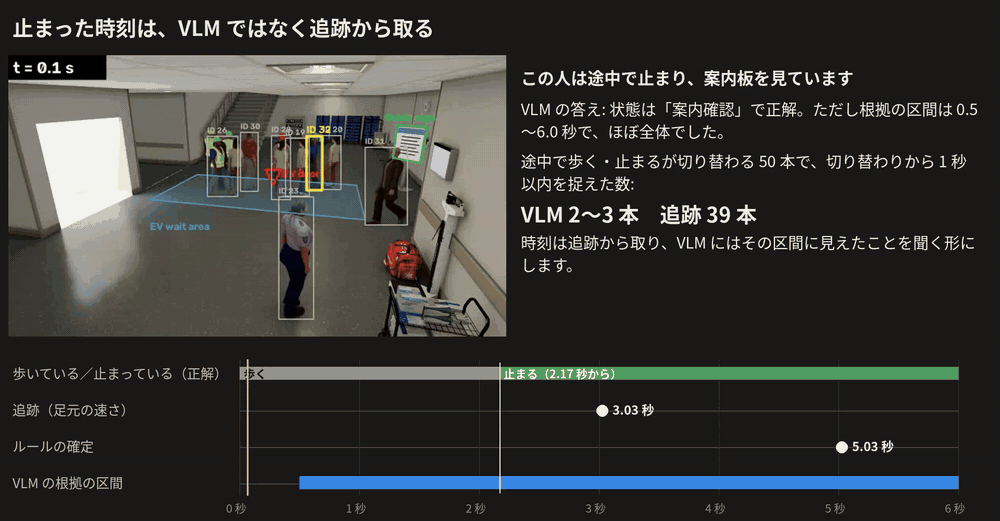

# Timing and compute

[Contents](README.en.md#toc) ｜ [← Results: state judgement](03_results.en.md) ｜ [Issues and people flow →](05_issues.en.md) ｜ [Glossary](glossary.en.md) ｜ [日本語](04_timing_cost.md)

**On this page**: [Stop times](#timing) · [Compute](#cost) · [Gaps and delay](#coverage)

## Stop times

Even when the state is right, the VLM could not give the time someone stopped. [Evidence intervals](glossary.en.md#evidence) will come from tracking, and the VLM will be asked what it saw in that interval.

Compared on 50 clips where walking and stopping switch once.

| Source of the time | Within 1 s of the switch | Median error |
|---|---|---|
| VLM evidence interval | 2–3 clips | 1.03–1.15 s |
| VLM frame-by-frame answers | 1 clip | — (a boundary appeared in only 1 clip) |
| **Tracking (foot speed)** | **39 clips** | 0.83 s |
| Rule confirmation | 0 clips | 2.9 s (late, because it waits to confirm) |

In 44 clips the VLM's interval was the whole clip. Drawing the time on each frame, or asking for per-action intervals and frame-by-frame walking, did not change this.

This person stops at 2.17 s. Tracking gives 3.03 s and the rule confirms at 5.03 s. The VLM's state is right, but its interval is 0.5–6.0 s, nearly the whole clip. [mp4](media/evidence_timing.mp4)

## Compute

| Item | [Hall A](glossary.en.md#hall-a-term) | [Hall B](glossary.en.md#hall-b-term) |
|---|---|---|
| VLM calls per minute | 115 | 80 |
| GPU time per hour of video | 9,286 s | 7,211 s |
| [GPUs](glossary.en.md#gpu-cards) per camera | 2.6 | 2.0 |
| If limited to 10–20% of the video (calculated) | 0.26–0.52 | 0.20–0.40 |

GPU: RTX PRO 6000, batches of 8. This covers the VLM only, not detection or tracking. The 10–20% row simply multiplies by the plan's budget and is not a measurement.

Running in real time requires selecting the video. This result suggests limiting it to candidates that position cannot settle ([research question 2](glossary.en.md#rq2), to be compared in December).

## Gaps and delay

| Item | Hall A | Hall B |
|---|---|---|
| Share of time with a VLM answer | 70% | 66% |
| Delay to judging companion wait (median) | 4.5 s | 4.75 s |

When there is no answer (the first 6 s of a track, an expired [time to live](glossary.en.md#ttl), short tracks), the rule's judgement is used. The delay comes from answering at the end of a clip and excludes VLM processing time.

---

[Contents](README.en.md#toc) ｜ [← Results: state judgement](03_results.en.md) ｜ [Issues and people flow →](05_issues.en.md) ｜ [Glossary](glossary.en.md) ｜ [Back to top](#top)
