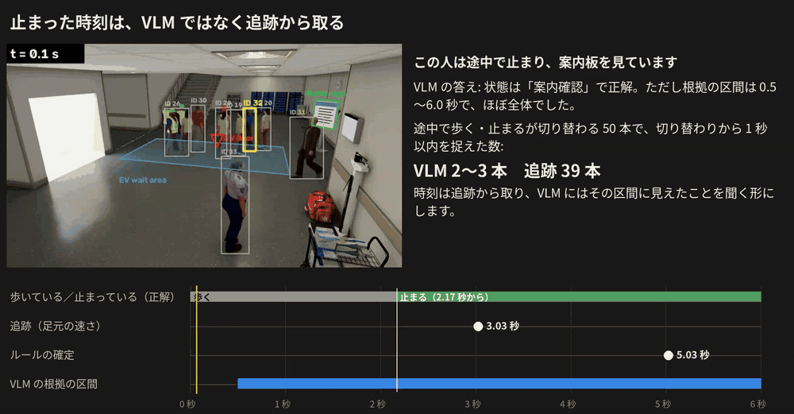

# 時刻と計算量

[目次](README.md#toc) ｜ [← 結果: 状態の判定](03_results.md) ｜ [課題と人数の流れ →](05_issues.md) ｜ [用語集](glossary.md) ｜ [English](04_timing_cost.en.md)

**このページ**: [止まった時刻](#timing)・[計算量](#cost)・[答えのない時間と遅れ](#coverage)

## 止まった時刻

状態が合っていても、止まった時刻は VLM からは取れなかった。[根拠の区間](glossary.md#evidence)は追跡から取り、VLM にはその区間に見えたことを聞く形に変える。

途中で歩く・止まるが切り替わる 50 本で比べた。

| 時刻の取り方 | 切り替わりから 1 秒以内 | 誤差の中央値 |
|---|---|---|
| VLM の根拠の区間 | 2〜3 本 | 1.03〜1.15 秒 |
| VLM のコマごとの答え | 1 本 | —（境い目を出せたのが 1 本だけ） |
| **追跡（足元の速さ）** | **39 本** | 0.83 秒 |
| ルールの確定 | 0 本 | 2.9 秒（確定するまで待つので遅れる） |

VLM は 44 本で区間がクリップ全体だった。コマに時刻を描き込み、動作ごとの区間やコマごとの歩いているかを聞いても、変わらなかった。

この人は 2.17 秒で止まる。追跡は 3.03 秒、ルールの確定は 5.03 秒。VLM の状態は正解だが、区間は 0.5〜6.0 秒でほぼ全体だった。[mp4](media/evidence_timing.mp4)

## 計算量

| 項目 | [広間 A](glossary.md#hall-a-term) | [広間 B](glossary.md#hall-b-term) |
|---|---|---|
| VLM の呼び出し（1 分あたり） | 115 回 | 80 回 |
| GPU の時間（映像 1 時間あたり） | 9,286 秒 | 7,211 秒 |
| カメラ 1 台に要る [GPU](glossary.md#gpu-cards) | 2.6 枚分 | 2.0 枚分 |
| 映像の 10〜20% に絞った場合（計算上） | 0.26〜0.52 枚分 | 0.20〜0.40 枚分 |

GPU は RTX PRO 6000（8 本ずつまとめて処理）。VLM の部分だけで、検出・追跡は含まない。10〜20% は計画書の予算の案に単純に掛けた値で、実測ではない。

実時間で動かすには映像を選ぶことが前提になる。位置で分からない候補に絞る案が今回の結果から出てきた（[研究課題 2](glossary.md#rq2)、12 月に比べる）。

## 答えのない時間と遅れ

| 項目 | 広間 A | 広間 B |
|---|---|---|
| VLM の答えがある時間の割合 | 70% | 66% |
| 同行者待ちと判定するまでの遅れ（中央値） | 4.5 秒 | 4.75 秒 |

答えがない時間（トラックの最初の 6 秒、[有効期限](glossary.md#ttl)切れ、短いトラック）はルールの判定を使う。遅れはクリップの終わりに答えるためで、VLM の処理の時間は入れていない。

---

[目次](README.md#toc) ｜ [← 結果: 状態の判定](03_results.md) ｜ [課題と人数の流れ →](05_issues.md) ｜ [用語集](glossary.md) ｜ [ページの先頭へ](#top)
