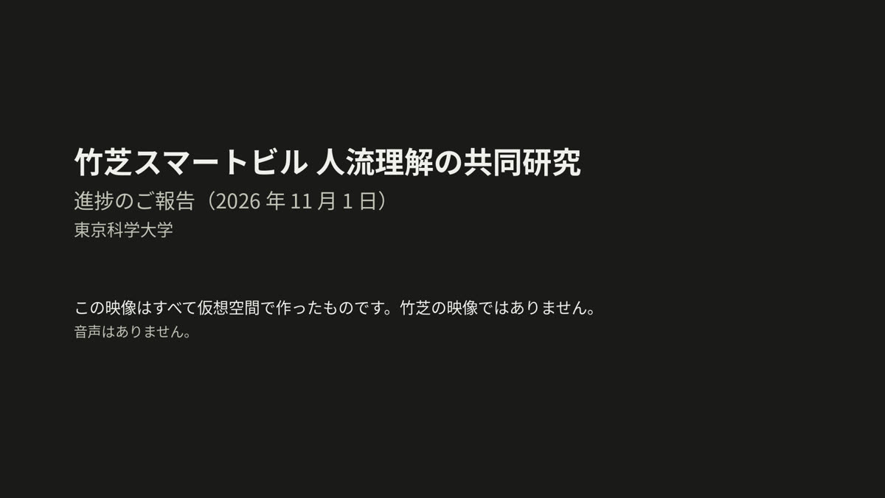

# Progress report (2026-11-01): understanding people flow at Takeshiba Smart Building

[Contents](README.en.md#toc) ｜ [Where we are →](01_status.en.md) ｜ [Glossary](glossary.en.md) ｜ [日本語](README.md)

> [!IMPORTANT]
> All videos and numbers come from a virtual space; no Takeshiba footage is used. The numbers check the procedure and are not a forecast of performance at Takeshiba.

## Conclusions

1. The procedure from video to [tracking](glossary.en.md#tracking) to [VLM](glossary.en.md#vlm) to evaluation now runs end to end in the virtual space.
2. The role of the VLM is narrowing. Where position tells the state, the [position rule](glossary.en.md#position-rule) is enough; the VLM's facing answer wins only where position does not tell.
3. The VLM cannot give the time a person stopped. Times will come from tracking instead.
4. Using the VLM on every candidate takes 2.0–2.6 GPUs per camera, so the video has to be selected.
5. Moving to Takeshiba footage needs [five confirmations](07_next.en.md#five-points). Preserving the recordings is the most urgent.

| State [F1](glossary.en.md#f1) (1 is perfect) | Position rule | Ask the VLM for the state | Rule + VLM facing |
|---|---|---|---|
| [Hall A](glossary.en.md#hall-a-term) (position tells) | **0.59** | 0.40 | 0.53 |
| [Hall B](glossary.en.md#hall-b-term) (position does not tell) | 0.42 | 0.36 | **0.49** |

See the [results table](03_results.en.md#table) for details and [what we cannot say](06_limits.en.md#cannot) for how to read these values.

## Overview video

1 min 54 s, no audio, captions in Japanese. Click the image to open the mp4 ([direct link](media/overview.mp4)).

## Find what you need

| I want to know | Go to |
|---|---|
| Where the project stands | [Schedule and status](01_status.en.md#schedule) |
| What has been produced | [Deliverables](01_status.en.md#deliverables) |
| What was compared | [The three methods](02_method.en.md#methods) |
| Which scenes were used | [The two scenes](02_method.en.md#scenes) |
| Whether the VLM helps | [Results table](03_results.en.md#table) |
| How it looks in motion | [Hall A video](03_results.en.md#hall-a), [Hall B video](03_results.en.md#hall-b) |
| Examples of failures | [Failures](03_results.en.md#misses) |
| Whether the comparison is fair | [The rule used as the baseline](03_results.en.md#fair-rule) |
| Whether stop times can be obtained | [Stop times](04_timing_cost.en.md#timing) |
| Whether it can run in real time | [Compute](04_timing_cost.en.md#cost) |
| Counts in crowded areas | [Issues found](05_issues.en.md#issues) |
| The flow of people from entrance to EV | [People flow](05_issues.en.md#flow) |
| How far the claims go | [What we can say](06_limits.en.md#can), [what we cannot say](06_limits.en.md#cannot) |
| How this differs from October | [Difference from the October values](06_limits.en.md#october) |
| What happens next | [Next steps](07_next.en.md#roadmap) |
| What needs confirming with the partners | [The five confirmations](07_next.en.md#five-points) |
| What a term means | [Glossary](glossary.en.md) |
| Every number | [All numbers](08_appendix.en.md#all-numbers) |

## Contents

- **[Progress report (2026-11-01): understanding people flow at Takeshiba Smart Building](README.en.md)**
  - [Conclusions](README.en.md#conclusion)
  - [Overview video](README.en.md#video)
  - [Find what you need](README.en.md#find)
  - [Files](README.en.md#files)
- **[Where we are](01_status.en.md)**
  - [Schedule and status](01_status.en.md#schedule)
  - [Deliverables](01_status.en.md#deliverables)
- **[What was compared](02_method.en.md)**
  - [The procedure](02_method.en.md#pipeline)
  - [The two scenes](02_method.en.md#scenes)
  - [The three methods](02_method.en.md#methods)
  - [How it was evaluated](02_method.en.md#evaluation)
- **[Results: state judgement](03_results.en.md)**
  - [Results table](03_results.en.md#table)
  - [Hall A video](03_results.en.md#hall-a)
  - [Hall B video](03_results.en.md#hall-b)
  - [Successes](03_results.en.md#hits)
  - [Failures](03_results.en.md#misses)
  - [The rule used as the baseline](03_results.en.md#fair-rule)
- **[Timing and compute](04_timing_cost.en.md)**
  - [Stop times](04_timing_cost.en.md#timing)
  - [Compute](04_timing_cost.en.md#cost)
  - [Gaps and delay](04_timing_cost.en.md#coverage)
- **[Issues and people flow](05_issues.en.md)**
  - [Issues found](05_issues.en.md#issues)
  - [People flow](05_issues.en.md#flow)
- **[What we can and cannot say](06_limits.en.md)**
  - [What we can say](06_limits.en.md#can)
  - [What we cannot say](06_limits.en.md#cannot)
  - [Difference from the October values](06_limits.en.md#october)
- **[What comes next](07_next.en.md)**
  - [Next steps](07_next.en.md#roadmap)
  - [The five confirmations](07_next.en.md#five-points)
- **[Appendix](08_appendix.en.md)**
  - [All numbers](08_appendix.en.md#all-numbers)
  - [Materials and credits](08_appendix.en.md#credits)
  - [How this report was made](08_appendix.en.md#how-built)
- **[Glossary](glossary.en.md)**
  - [States](glossary.en.md#g-states)
  - [Methods](glossary.en.md#g-methods)
  - [Technology](glossary.en.md#g-tech)
  - [Evaluation](glossary.en.md#g-eval)
  - [Scenes and plan](glossary.en.md#g-plan)

## Files

- [Slides as PDF](media/takeshiba_progress_2026-11-01.pdf) (22 pages, in Japanese; videos shown as stills)
- [Numbers file](data/numbers.json) (the source of the numbers on these pages)

---

[Contents](README.en.md#toc) ｜ [Where we are →](01_status.en.md) ｜ [Glossary](glossary.en.md) ｜ [Back to top](#top)
