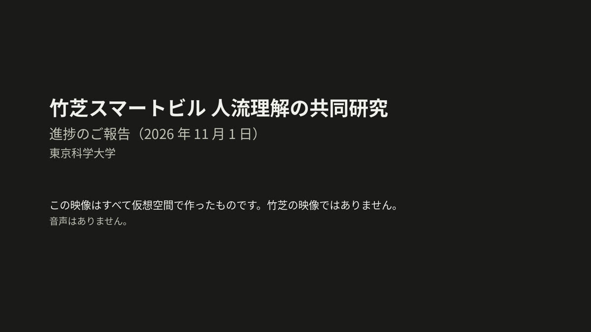

# 進捗の報告（2026-11-01）竹芝スマートビルの人流理解

[目次](README.md#toc) ｜ [今の位置 →](01_status.md) ｜ [用語集](glossary.md) ｜ [English](README.en.md)

> [!IMPORTANT]
> 映像と数値はすべて仮想空間のもので、竹芝の映像は使っていない。数値は手順の確認であり、竹芝での性能の見込みではない。

## 結論

1. 映像 → [追跡](glossary.md#tracking) → [VLM](glossary.md#vlm) → 評価の手順が、仮想空間で一通り動いた。
2. VLM の使い道が絞れてきた。位置で状態が分かる場面は[位置のルール](glossary.md#position-rule)で足り、VLM の向きが上回るのは位置で分からない場面だけだった。
3. 止まった時刻は VLM では取れない。時刻は追跡から取る形に変える。
4. 全部の候補に VLM を使うと、カメラ 1 台に GPU 2.0〜2.6 枚分かかる。映像を選んで使う前提になる。
5. 竹芝の映像に進むには [5 点の確認](07_next.md#five-points)が要る。録画の保全がいちばん急ぐ。

| 状態の [F1](glossary.md#f1)（1 が満点） | 位置のルール | VLM に状態を聞く | ルール＋VLM の向き |
|---|---|---|---|
| [広間 A](glossary.md#hall-a-term)（位置で分かる） | **0.59** | 0.40 | 0.53 |
| [広間 B](glossary.md#hall-b-term)（位置で分からない） | 0.42 | 0.36 | **0.49** |

詳しくは [結果の表](03_results.md#table)。この値の読み方の注意は [言えないこと](06_limits.md#cannot)。

## 概要の映像

1 分 54 秒・音声なし・字幕は日本語。画像をクリックすると mp4 を開く（[直接開く](media/overview.mp4)）。

## 知りたいことから探す

| 知りたいこと | 行き先 |
|---|---|
| 今どこまで進んでいるか | [予定と今の状況](01_status.md#schedule) |
| 何ができたのか | [できたもの](01_status.md#deliverables) |
| 何と何を比べたのか | [3 つの方式](02_method.md#methods) |
| どんな場面で試したのか | [2 つの場面](02_method.md#scenes) |
| VLM は役に立つのか | [結果の表](03_results.md#table) |
| 動いているところを見たい | [広間 A の映像](03_results.md#hall-a)・[広間 B の映像](03_results.md#hall-b) |
| 外れの例を見たい | [外れの例](03_results.md#misses) |
| 比べ方は公平なのか | [比べる相手のルール](03_results.md#fair-rule) |
| 止まった時刻は分かるのか | [止まった時刻](04_timing_cost.md#timing) |
| 実時間で動かせるのか | [計算量](04_timing_cost.md#cost) |
| 混雑した所の人数は | [見えてきた課題](05_issues.md#issues) |
| 入口から EV までの人数の流れは | [人数の流れ](05_issues.md#flow) |
| どこまで言ってよいのか | [言えること](06_limits.md#can)・[言えないこと](06_limits.md#cannot) |
| 10 月の値とどう違うのか | [10 月の値との違い](06_limits.md#october) |
| 次に何をするのか | [これから進めること](07_next.md#roadmap) |
| 先方に何を確認するのか | [確認する 5 点](07_next.md#five-points) |
| 言葉の意味が分からない | [用語集](glossary.md) |
| 全部の数値を見たい | [全部の数値](08_appendix.md#all-numbers) |

## 目次

- **[進捗の報告（2026-11-01）竹芝スマートビルの人流理解](README.md)**
  - [結論](README.md#conclusion)
  - [概要の映像](README.md#video)
  - [知りたいことから探す](README.md#find)
  - [ファイル](README.md#files)
- **[今の位置](01_status.md)**
  - [予定と今の状況](01_status.md#schedule)
  - [できたもの](01_status.md#deliverables)
- **[何を比べたか](02_method.md)**
  - [手順の全体](02_method.md#pipeline)
  - [2 つの場面](02_method.md#scenes)
  - [3 つの方式](02_method.md#methods)
  - [評価のしかた](02_method.md#evaluation)
- **[結果: 状態の判定](03_results.md)**
  - [結果の表](03_results.md#table)
  - [広間 A の映像](03_results.md#hall-a)
  - [広間 B の映像](03_results.md#hall-b)
  - [当たりの例](03_results.md#hits)
  - [外れの例](03_results.md#misses)
  - [比べる相手のルール](03_results.md#fair-rule)
- **[時刻と計算量](04_timing_cost.md)**
  - [止まった時刻](04_timing_cost.md#timing)
  - [計算量](04_timing_cost.md#cost)
  - [答えのない時間と遅れ](04_timing_cost.md#coverage)
- **[課題と人数の流れ](05_issues.md)**
  - [見えてきた課題](05_issues.md#issues)
  - [人数の流れ](05_issues.md#flow)
- **[言えること・言えないこと](06_limits.md)**
  - [言えること](06_limits.md#can)
  - [言えないこと](06_limits.md#cannot)
  - [10 月の値との違い](06_limits.md#october)
- **[次に進めること](07_next.md)**
  - [これから進めること](07_next.md#roadmap)
  - [確認する 5 点](07_next.md#five-points)
- **[補足](08_appendix.md)**
  - [全部の数値](08_appendix.md#all-numbers)
  - [素材と出典](08_appendix.md#credits)
  - [この報告の作り方](08_appendix.md#how-built)
- **[用語集](glossary.md)**
  - [状態](glossary.md#g-states)
  - [方式](glossary.md#g-methods)
  - [技術](glossary.md#g-tech)
  - [評価](glossary.md#g-eval)
  - [場面と計画](glossary.md#g-plan)

## ファイル

- [発表資料の PDF](media/takeshiba_progress_2026-11-01.pdf)（22 枚。映像は静止画）
- [数値のファイル](data/numbers.json)（このページの数値の元）

---

[目次](README.md#toc) ｜ [今の位置 →](01_status.md) ｜ [用語集](glossary.md) ｜ [ページの先頭へ](#top)
